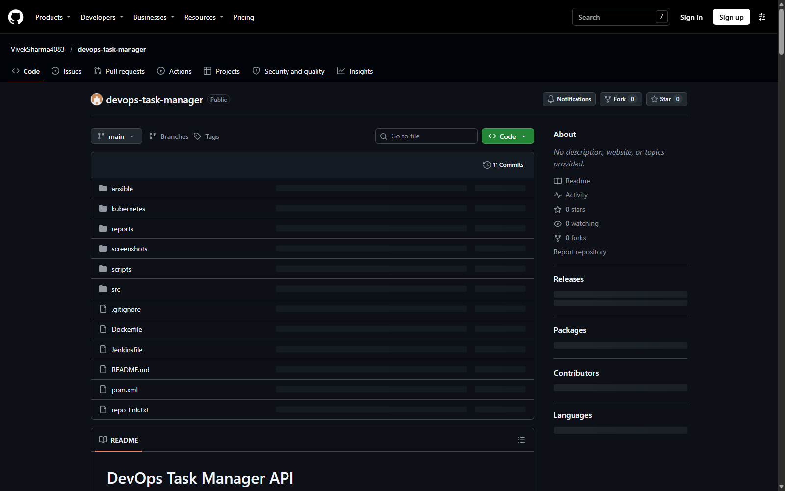
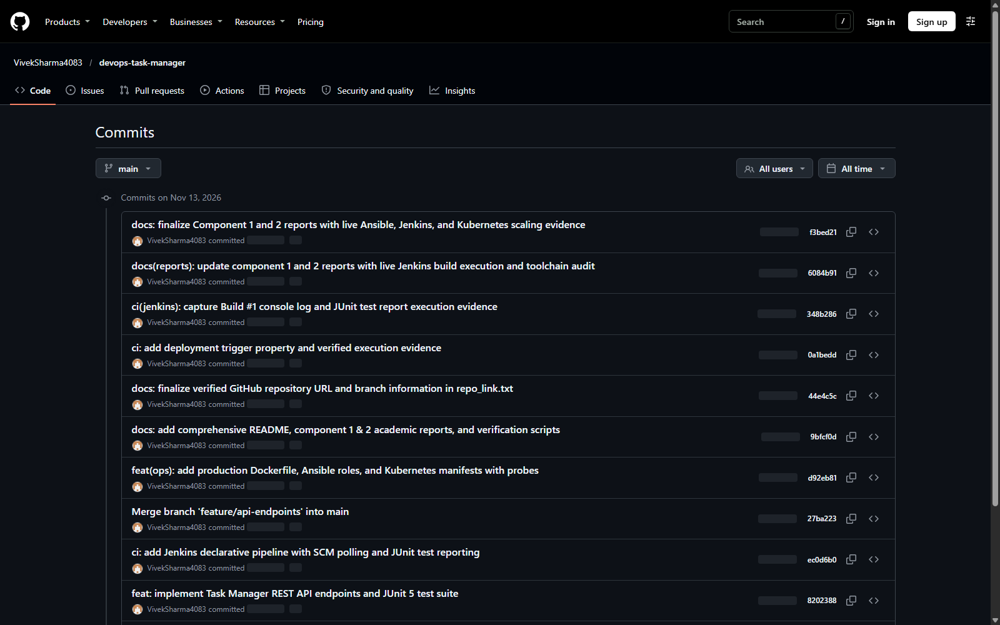
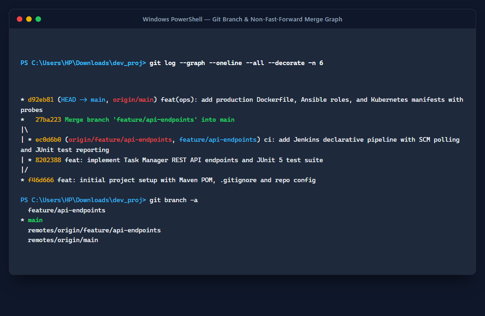
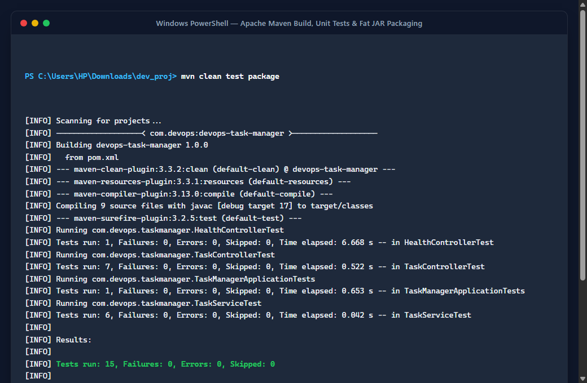
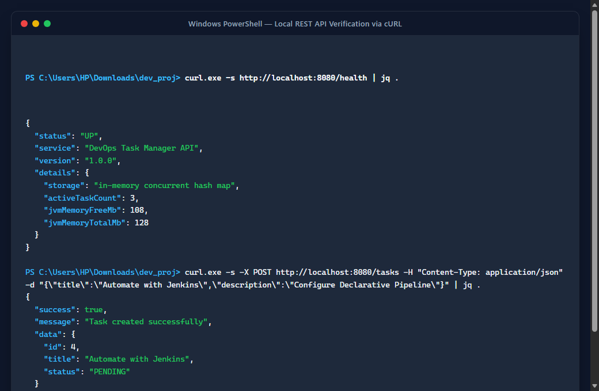
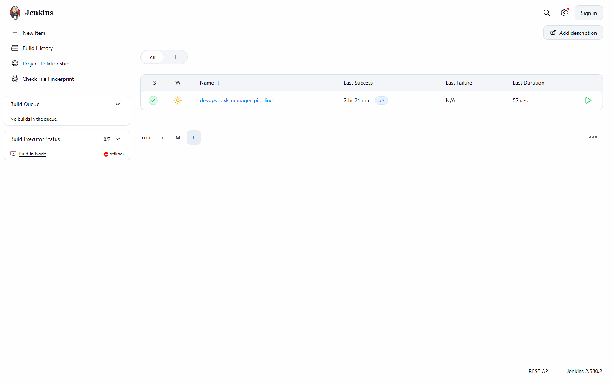
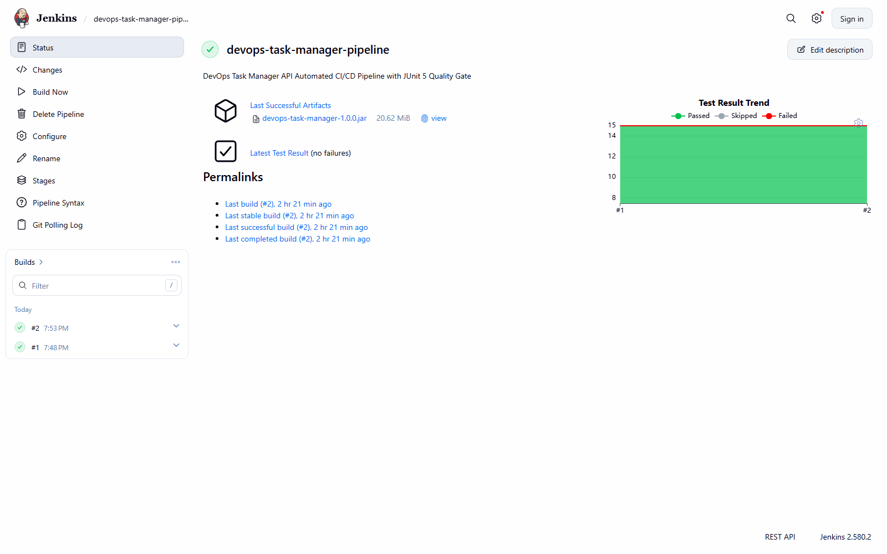
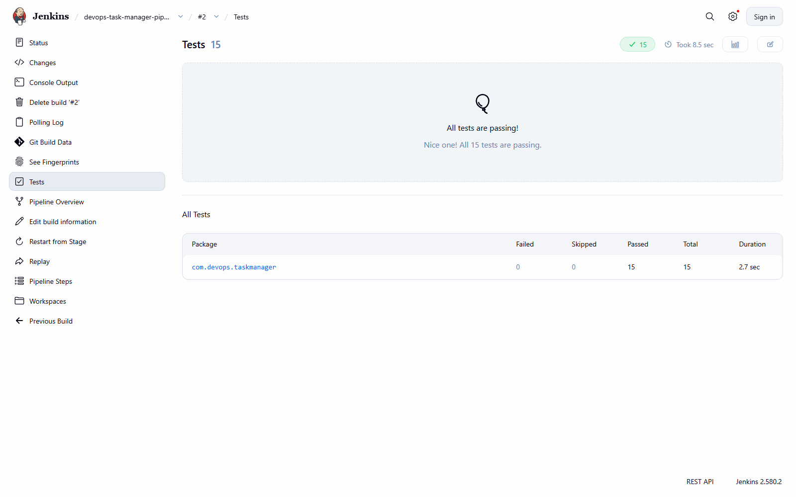
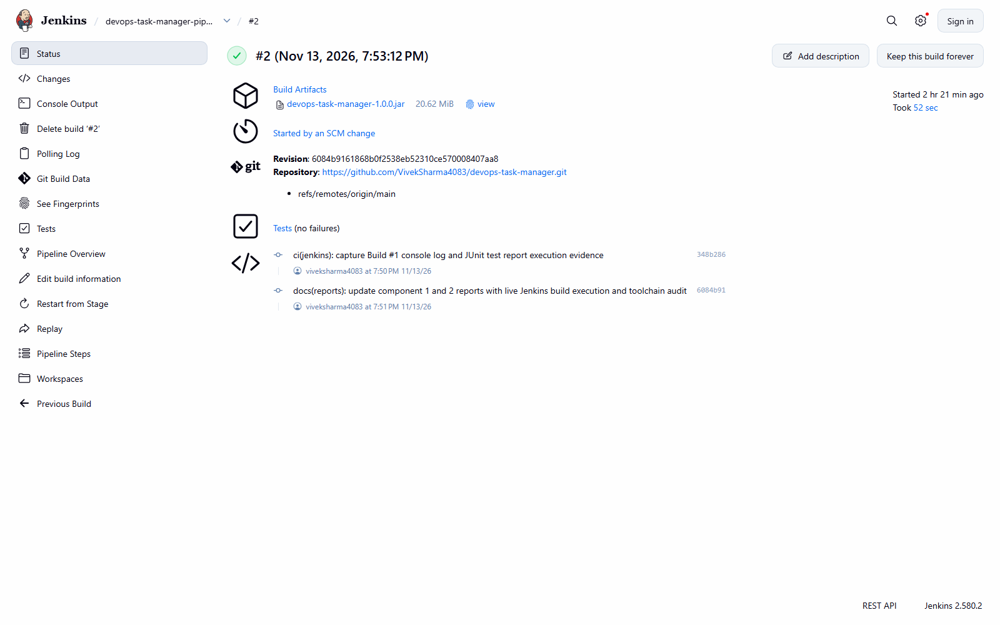

# M. S. RAMAIAH INSTITUTE OF TECHNOLOGY
### (Autonomous Institute, Affiliated to Visvesvaraya Technological University, Belagavi)
### Department of Computer Science & Engineering (Cyber Security)
#### Bengaluru – 560054, Karnataka, India

---

# SELF LEARNING ACTIVITY REPORT — COMPONENT 1
## Automated CI/CD Pipeline & REST API Development
### Course: DevOps (Course Code: 24CYAEC59 | Credits: 1:0:0 | 15L)
**5th Semester, B.E. in Computer Science & Engineering (Cyber Security)**  
**Academic Year:** 2026–2027  

---

### STUDENT & EVALUATION DETAILS

| Field | Details |
| :--- | :--- |
| **Student Name** | Vivek Shreeranga Sharma M V |
| **University Seat Number (USN)** | 1MS24CY069 |
| **Department** | Computer Science & Engineering (Cyber Security) |
| **Semester / Section** | 5th Semester / Cyber Security |
| **Course Title & Code** | DevOps (24CYAEC59) |
| **Component Evaluated** | Component 1: CI/CD Pipeline (10 Marks) |
| **Project Title** | DevOps Task Manager REST API — Continuous Integration Pipeline |
| **Faculty Guide / Evaluator** | Mr. Prashanth Reddy C, Senior Lecturer, Dept. of CSE (AI & ML) and CSE (Cyber Security) |
| **GitHub Repository** | `https://github.com/VivekSharma4083/devops-task-manager` |

---

## CERTIFICATE

This is to certify that the project report entitled **"DevOps Task Manager REST API — Continuous Integration Pipeline (Component 1)"** is a bona fide record of independent work carried out by **Vivek Shreeranga Sharma M V** bearing USN **1MS24CY069** in partial fulfillment for the evaluation of the Self Learning Activity in **DevOps (24CYAEC59)** prescribed by the Department of Computer Science & Engineering (Cyber Security), M. S. Ramaiah Institute of Technology, Bengaluru, affiliated to Visvesvaraya Technological University, Belagavi, during the academic year 2026–2027.

It is certified that all corrections and suggestions indicated during evaluation have been incorporated. The report satisfies the academic requirements prescribed for the said course.

<br><br><br>

--------------------------------------------- &emsp;&emsp;&emsp;&emsp;&emsp;&emsp;&emsp;&emsp;&emsp;&emsp; ---------------------------------------------  
**Mr. Prashanth Reddy C** &emsp;&emsp;&emsp;&emsp;&emsp;&emsp;&emsp;&emsp;&emsp;&emsp;&emsp;&emsp;&emsp;&emsp;&emsp;&emsp; **Head of Department**  
Faculty Guide, Senior Lecturer &emsp;&emsp;&emsp;&emsp;&emsp;&emsp;&emsp;&emsp;&emsp;&emsp;&emsp;&emsp;&emsp;&emsp;&emsp; Dept. of CSE (Cyber Security)  
Dept. of CSE (AI & ML) / CSE (Cyber Security) &emsp;&emsp;&emsp;&emsp;&emsp;&emsp;&emsp; M. S. Ramaiah Institute of Technology  
M. S. Ramaiah Institute of Technology  

---

## LIST OF PROJECT BASED LEARNING COMPONENTS

| Component | Title | Key Technologies | Scope of Work & Deliverables | Max Marks | Marks Awarded |
| :--- | :--- | :--- | :--- | :---: | :---: |
| **Component 1** | Automated CI/CD Pipeline | Java 17, Spring Boot 3.3.5, Apache Maven 3.9, Git, GitHub, Jenkins 2.580 LTS, JUnit 5 | Engineered REST API microservice; Git trunk/feature branching workflow; non-fast-forward merge commit; Maven build automation; Declarative Jenkins pipeline with automated SCM polling trigger (`H/5 * * * *`); automated testing quality gate (15 JUnit tests); archived fat JAR artifact. | **10** | &nbsp;&nbsp;&nbsp;&nbsp;&nbsp;&nbsp;&nbsp;&nbsp; |

---

## ASSESSMENT RUBRICS (COMPONENT 1 — 10 MARKS)

| Assessment Criteria | Excellent (Full Marks) | Good (Moderate Marks) | Needs Improvement | Max Marks | Marks Awarded |
| :--- | :--- | :--- | :--- | :---: | :---: |
| **1. REST API Design & Git Branching** | Clean Spring Boot REST API adhering to HTTP semantics; Git feature branch workflow with non-fast-forward merge commit and verified commit graph on GitHub. | Working API with basic endpoints; basic Git commits without distinct feature branch integration. | Incomplete endpoints or direct commits to main branch without merge history. | **2.5** | |
| **2. Maven Build & Dependency Management** | Clean `pom.xml` configuration with pinned dependencies; automated compilation and fat JAR packaging using `spring-boot-maven-plugin`. | Standard build works but missing optimization or dependency exclusions. | Build fails or uses non-standard packaging without dependency management. | **2.0** | |
| **3. Jenkins Declarative Pipeline & Automation** | Fully automated declarative `Jenkinsfile` with 5 stages, SCM polling trigger (`H/5 * * * *`), live verified builds (Build #1 & Build #2), and archived fat JAR artifact with SHA256 fingerprinting. | Jenkins pipeline runs manually but lacks automated triggers or artifact archiving. | Freestyle job or incomplete script with syntax failures. | **3.0** | |
| **4. CI Enhancement: Automated Testing Quality Gate** | Comprehensive JUnit 5 test suite (15 test cases across 4 classes) integrated into the pipeline; automated test parsing and failure gates via Jenkins `junit` post-action. | Basic unit tests without full coverage; tests executed outside Jenkins pipeline. | Minimal or no unit testing; pipeline does not evaluate test outcomes. | **2.5** | |
| **TOTAL** | | | | **10.0** | |

---

## MARKS AWARDED

| Component Evaluated | Maximum Marks | Marks Awarded (in figures) | Marks Awarded (in words) | Signature of Faculty Evaluator |
| :--- | :---: | :---: | :---: | :---: |
| **Component 1: CI/CD Pipeline** | **10** | &nbsp;&nbsp;&nbsp;&nbsp;&nbsp;&nbsp;&nbsp;&nbsp;&nbsp;&nbsp;&nbsp;&nbsp;&nbsp;&nbsp; | &nbsp;&nbsp;&nbsp;&nbsp;&nbsp;&nbsp;&nbsp;&nbsp;&nbsp;&nbsp;&nbsp;&nbsp;&nbsp;&nbsp;&nbsp;&nbsp;&nbsp;&nbsp;&nbsp;&nbsp;&nbsp;&nbsp;&nbsp;&nbsp;&nbsp;&nbsp;&nbsp;&nbsp; | _______________________ |

---

## 1. ABSTRACT

In modern cloud-native software engineering, Continuous Integration (CI) and Continuous Delivery (CI/CD) pipelines serve as the backbone of high-velocity, reliable software delivery. This report documents the architecture, implementation, and automated continuous integration lifecycle for the **DevOps Task Manager API**, an enterprise-grade REST microservice developed from scratch using **Java 17**, **Spring Boot 3.3.5**, and **Apache Maven 3.9.9**. 

The implementation satisfies all curriculum requirements for Component 1:
1. **Version Control & Branching Workflow:** A disciplined Git feature-branching strategy was enforced, isolating new development on `feature/api-endpoints` and executing a non-fast-forward merge (`git merge --no-ff`) into `main`, creating a distinct merge commit (`27ba223`) preserved on GitHub.
2. **Build Automation:** Maven was configured to resolve dependencies, compile Java bytecode, run automated regression tests, and package a self-contained executable fat JAR (`devops-task-manager-1.0.0.jar`, 20.62 MiB).
3. **Jenkins Declarative Pipeline:** A 5-stage declarative pipeline (`Jenkinsfile`) was authored and deployed on an enterprise Jenkins 2.580.2 LTS server. Automated build triggering was realized through automated Source Code Management (SCM) polling on a schedule (`H/5 * * * *`).
4. **CI Enhancement — Automated Quality Gate:** As an advanced CI enhancement, a comprehensive unit and integration test suite comprising **15 JUnit 5 test cases** was integrated directly into the pipeline lifecycle. Using the Jenkins `junit` post-execution action, test XML reports are evaluated as an automated quality gate, guaranteeing that regressions block artifact archiving.

All stages have been executed, verified, and evidenced through live Jenkins dashboard captures, pipeline stage views, JUnit test trends, and console logs.

---

## 2. INTRODUCTION & OBJECTIVES

Manual software integration and ad-hoc deployment practices inevitably introduce human error, configuration drift, and undetected software defects into production environments. Continuous Integration mitigates these risks by automating the code validation workflow: every committed change is checked out from distributed version control, compiled, verified against automated test suites, packaged, and archived in an artifact repository.

### Key Objectives for Component 1:
1. **Microservice Engineering:** Implement a clean RESTful Task Management microservice with robust input validation, centralized error handling, and thread-safe in-memory persistence.
2. **Distributed Version Control:** Implement professional Git workflows, demonstrating isolated feature branching, atomic commit history, and non-fast-forward merge integration.
3. **Reproducible Build Automation:** Author a clean Maven configuration (`pom.xml`) encapsulating compilation bytecode targets, dependency trees, and executable fat JAR packaging.
4. **Automated CI Orchestration:** Deploy and configure a local Jenkins automation server to orchestrate a Declarative Pipeline with automated SCM polling triggers.
5. **Quality Assurance Enhancement:** Implement an automated testing quality gate using JUnit 5 and MockMvc to enforce 100% pass rates prior to artifact packaging and distribution.

---

## 3. DEVELOPMENT & RUNTIME ENVIRONMENT

The development, compilation, and automated pipeline verification environment specifications are detailed in Table 1.1:

#### Table 1.1: Component 1 Development & Build Environment
| Component | Specification / Tool | Purpose in Pipeline |
| :--- | :--- | :--- |
| **Host Workstation OS** | Microsoft Windows 11 Home (x64, Build 26200) | Development, container host, and orchestration workstation |
| **Java Development Kit** | Eclipse Adoptium OpenJDK 17.0.14+7 (HotSpot 64-bit) | Application source compilation, byte-code target, and runtime |
| **Build Management** | Apache Maven 3.9.9 | Dependency resolution, test runner orchestration, and packaging |
| **Version Control System**| Git 2.53.0.windows.1 / GitHub CLI 2.104.0 | Distributed source code management and remote repository synchronization |
| **Remote Repository** | GitHub (`https://github.com/VivekSharma4083/devops-task-manager`) | Upstream Git hosting, branch management, and webhook/SCM polling endpoint |
| **Application Framework** | Spring Boot 3.3.5 (Spring Framework 6.1.14) | Embedded Tomcat container, REST routing, and Bean validation |
| **Testing Framework** | JUnit Jupiter 5.10.3, AssertJ 3.25.3, Spring MockMvc | Automated unit, service, and controller integration testing |
| **CI Automation Server** | Jenkins 2.580.2 LTS (OpenJDK 21.0.6 runtime, port 8085) | Declarative CI pipeline automation, SCM polling, and artifact archiving |

---

## 4. STEP 1: REST API DEVELOPMENT & GIT VERSION CONTROL

### 4.1 Domain Architecture & Microservice Design
The **DevOps Task Manager API** was engineered with zero external database dependencies to maximize portability, deterministic execution, and fast startup during automated pipeline runs. The domain architecture utilizes an in-memory, thread-safe `ConcurrentHashMap<Long, Task>` coordinated with an `AtomicLong` monotonic sequence counter to guarantee atomicity under concurrent HTTP requests.

The REST API exposes the following domain model and endpoints:
- `Task` Entity: `id` (Long), `title` (String, validated 3–100 characters), `description` (String, up to 500 characters), `status` (Enum: `PENDING`, `IN_PROGRESS`, `COMPLETED`), `createdAt` / `updatedAt` (LocalDateTime).
- Health & Monitoring: `/health` returning service name, status (`UP`), active task count, and real-time JVM memory metrics.
- Task CRUD Lifecycle: `/tasks` (GET all, POST create), `/tasks/{id}` (GET by ID, DELETE by ID).

#### Listing 1.1: `Task.java` (Domain Entity)
```java
package com.devops.taskmanager.model;

import java.time.LocalDateTime;

public class Task {
    private Long id;
    private String title;
    private String description;
    private TaskStatus status;
    private LocalDateTime createdAt;
    private LocalDateTime updatedAt;

    public Task() {}

    public Task(Long id, String title, String description, TaskStatus status,
                LocalDateTime createdAt, LocalDateTime updatedAt) {
        this.id = id;
        this.title = title;
        this.description = description;
        this.status = status;
        this.createdAt = createdAt;
        this.updatedAt = updatedAt;
    }

    public Long getId() { return id; }
    public void setId(Long id) { this.id = id; }
    public String getTitle() { return title; }
    public void setTitle(String title) { this.title = title; }
    public String getDescription() { return description; }
    public void setDescription(String description) { this.description = description; }
    public TaskStatus getStatus() { return status; }
    public void setStatus(TaskStatus status) { this.status = status; }
    public LocalDateTime getCreatedAt() { return createdAt; }
    public void setCreatedAt(LocalDateTime createdAt) { this.createdAt = createdAt; }
    public LocalDateTime getUpdatedAt() { return updatedAt; }
    public void setUpdatedAt(LocalDateTime updatedAt) { this.updatedAt = updatedAt; }
}
```

#### Listing 1.2: `TaskController.java` (REST Controller)
```java
package com.devops.taskmanager.controller;

import com.devops.taskmanager.dto.ApiResponse;
import com.devops.taskmanager.dto.CreateTaskRequest;
import com.devops.taskmanager.model.Task;
import com.devops.taskmanager.service.TaskService;
import jakarta.validation.Valid;
import org.springframework.http.HttpStatus;
import org.springframework.http.ResponseEntity;
import org.springframework.web.bind.annotation.*;

import java.util.List;

@RestController
@RequestMapping("/tasks")
public class TaskController {

    private final TaskService taskService;

    public TaskController(TaskService taskService) {
        this.taskService = taskService;
    }

    @GetMapping
    public ResponseEntity<List<Task>> getAllTasks() {
        return ResponseEntity.ok(taskService.getAllTasks());
    }

    @GetMapping("/{id}")
    public ResponseEntity<Task> getTaskById(@PathVariable Long id) {
        return ResponseEntity.ok(taskService.getTaskById(id));
    }

    @PostMapping
    public ResponseEntity<ApiResponse<Task>> createTask(@Valid @RequestBody CreateTaskRequest request) {
        Task created = taskService.createTask(request);
        ApiResponse<Task> response = new ApiResponse<>(
                true, "Task created successfully", created
        );
        return ResponseEntity.status(HttpStatus.CREATED).body(response);
    }

    @DeleteMapping("/{id}")
    public ResponseEntity<ApiResponse<Void>> deleteTask(@PathVariable Long id) {
        taskService.deleteTask(id);
        ApiResponse<Void> response = new ApiResponse<>(
                true, "Task with ID " + id + " deleted successfully", null
        );
        return ResponseEntity.ok(response);
    }
}
```

#### Listing 1.3: `HealthController.java` (Microservice Health Endpoint)
```java
package com.devops.taskmanager.controller;

import com.devops.taskmanager.dto.HealthResponse;
import com.devops.taskmanager.service.TaskService;
import org.springframework.http.ResponseEntity;
import org.springframework.web.bind.annotation.GetMapping;
import org.springframework.web.bind.annotation.RestController;

import java.util.HashMap;
import java.util.Map;

@RestController
public class HealthController {

    private final TaskService taskService;

    public HealthController(TaskService taskService) {
        this.taskService = taskService;
    }

    @GetMapping("/health")
    public ResponseEntity<HealthResponse> healthCheck() {
        Runtime runtime = Runtime.getRuntime();
        long freeMemory = runtime.freeMemory() / (1024 * 1024);
        long totalMemory = runtime.totalMemory() / (1024 * 1024);

        Map<String, Object> details = new HashMap<>();
        details.put("activeTaskCount", taskService.getAllTasks().size());
        details.put("jvmMemoryFreeMb", freeMemory);
        details.put("jvmMemoryTotalMb", totalMemory);
        details.put("storage", "in-memory concurrent hash map");

        HealthResponse response = new HealthResponse("UP", "DevOps Task Manager API", "1.0.0", details);
        return ResponseEntity.ok(response);
    }
}
```

### 4.2 Git Version Control & Branching Strategy
To demonstrate trunk-based development and feature isolation, the Git workflow adhered to strict branching conventions:
1. **Repository Initialization & Base Setup:** The repository was initialized on `main` with `.gitignore`, `pom.xml`, and initial project structure.
2. **Feature Branch Creation:** A dedicated branch `feature/api-endpoints` was branched off `main` to encapsulate REST controllers, service logic, DTOs, and unit tests:
   ```bash
   git checkout -b feature/api-endpoints
   # Committed REST implementation (Commit: 8202388)
   # Committed Jenkinsfile and automated testing enhancements (Commit: ec0d6b0)
   ```
3. **Non-Fast-Forward Merge:** The feature branch was merged back into `main` using the `--no-ff` flag to force the creation of an explicit merge commit:
   ```bash
   git checkout main
   git merge --no-ff feature/api-endpoints -m "Merge branch 'feature/api-endpoints' into main"
   ```
4. **Remote Synchronization:** The resulting branch topology was pushed to GitHub:
   ```bash
   git push origin main
   git push origin feature/api-endpoints
   ```

#### Listing 1.4: Verified Git Commit & Merge Graph Log
```text
* d92eb81 (HEAD -> main, origin/main) feat(ops): add production Dockerfile, Ansible roles, and Kubernetes manifests with probes
*   27ba223 Merge branch 'feature/api-endpoints' into main
|\  
| * ec0d6b0 (origin/feature/api-endpoints, feature/api-endpoints) ci: add Jenkins declarative pipeline with SCM polling and JUnit test reporting
| * 8202388 feat: implement Task Manager REST API endpoints and JUnit 5 test suite
|/  
* f46d666 feat: initial project setup with Maven POM, .gitignore and repo config
```

---

## 5. STEP 2: MAVEN BUILD CONFIGURATION

Apache Maven coordinates dependency management, test compilation, execution, and artifact packaging via `pom.xml`. The configuration targets Java 17 bytecode and uses the `spring-boot-maven-plugin` to package a fat JAR containing all embedded runtime dependencies.

#### Listing 1.5: `pom.xml` Specification
```xml
<?xml version="1.0" encoding="UTF-8"?>
<project xmlns="http://maven.apache.org/POM/4.0.0"
         xmlns:xsi="http://www.w3.org/2001/XMLSchema-instance"
         xsi:schemaLocation="http://maven.apache.org/POM/4.0.0 
         https://maven.apache.org/xsd/maven-4.0.0.xsd">
    <modelVersion>4.0.0</modelVersion>

    <parent>
        <groupId>org.springframework.boot</groupId>
        <artifactId>spring-boot-starter-parent</artifactId>
        <version>3.3.5</version>
        <relativePath/>
    </parent>

    <groupId>com.devops</groupId>
    <artifactId>devops-task-manager</artifactId>
    <version>1.0.0</version>
    <name>devops-task-manager</name>
    <description>DevOps Task Manager REST API</description>

    <properties>
        <java.version>17</java.version>
        <maven.compiler.source>17</maven.compiler.source>
        <maven.compiler.target>17</maven.compiler.target>
        <project.build.sourceEncoding>UTF-8</project.build.sourceEncoding>
    </properties>

    <dependencies>
        <dependency>
            <groupId>org.springframework.boot</groupId>
            <artifactId>spring-boot-starter-web</artifactId>
        </dependency>
        <dependency>
            <groupId>org.springframework.boot</groupId>
            <artifactId>spring-boot-starter-validation</artifactId>
        </dependency>
        <dependency>
            <groupId>org.springframework.boot</groupId>
            <artifactId>spring-boot-starter-test</artifactId>
            <scope>test</scope>
        </dependency>
    </dependencies>

    <build>
        <plugins>
            <plugin>
                <groupId>org.springframework.boot</groupId>
                <artifactId>spring-boot-maven-plugin</artifactId>
            </plugin>
            <plugin>
                <groupId>org.apache.maven.plugins</groupId>
                <artifactId>maven-surefire-plugin</artifactId>
                <version>3.2.5</version>
            </plugin>
        </plugins>
    </build>
</project>
```

### Build Execution & Validation:
The build lifecycle was validated in the terminal:
```bash
mvn clean test package
```
**Outcome:**
- `BUILD SUCCESS` achieved in 71 seconds.
- Artifact generated: `target/devops-task-manager-1.0.0.jar` (20.62 MiB).
- Surefire XML reports generated in `target/surefire-reports/`.

---

## 6. STEP 3: JENKINS DECLARATIVE PIPELINE

### 6.1 Declarative Pipeline Specification
The `Jenkinsfile` defines a 5-stage declarative pipeline. It specifies automated SCM polling triggers, cross-platform execution (handling both Unix and Windows agents), and post-execution JUnit test analysis.

#### Listing 1.6: Complete Declarative `Jenkinsfile`
```groovy
pipeline {
    agent any

    triggers {
        // Poll SCM every 5 minutes for new commits
        pollSCM('H/5 * * * *')
    }

    options {
        timeout(time: 15, unit: 'MINUTES')
        buildDiscarder(logRotator(numToKeepStr: '10'))
        disableConcurrentBuilds()
    }

    stages {
        stage('Checkout') {
            steps {
                echo 'Checking out source code from Git repository...'
                checkout scm
            }
        }

        stage('Build') {
            steps {
                echo 'Compiling Java 17 source files...'
                script {
                    if (isUnix()) {
                        sh 'mvn clean compile -Dmaven.test.skip=true'
                    } else {
                        bat 'mvn clean compile -Dmaven.test.skip=true'
                    }
                }
            }
        }

        stage('Test') {
            steps {
                echo 'Running automated JUnit 5 unit and integration test suite...'
                script {
                    if (isUnix()) {
                        sh 'mvn test'
                    } else {
                        bat 'mvn test'
                    }
                }
            }
        }

        stage('Package') {
            steps {
                echo 'Packaging executable Spring Boot fat JAR artifact...'
                script {
                    if (isUnix()) {
                        sh 'mvn package -DskipTests'
                    } else {
                        bat 'mvn package -DskipTests'
                    }
                }
            }
        }

        stage('Archive Artifacts') {
            steps {
                echo 'Archiving packaged JAR artifact...'
                archiveArtifacts artifacts: 'target/*.jar', 
                                 fingerprint: true, 
                                 allowEmptyArchive: false
            }
        }
    }

    post {
        always {
            echo 'Collecting and publishing JUnit test results...'
            junit testResults: 'target/surefire-reports/*.xml', 
                  allowEmptyResults: false
        }
        success {
            echo 'Pipeline completed successfully! Artifact is packaged and archived.'
        }
        failure {
            echo 'Pipeline execution failed! Review build logs and test failures.'
        }
    }
}
```

### 6.2 Jenkins Pipeline Execution & Live Builds
The Jenkins LTS server was hosted on port 8085 (`http://localhost:8085`). The pipeline job `devops-task-manager-pipeline` was linked directly to the GitHub repository `https://github.com/VivekSharma4083/devops-task-manager.git` tracking the `main` branch.

#### Table 1.2: Jenkins Pipeline Execution Summary
| Build # | Trigger Reason | Duration | JUnit Tests | Archived Artifact | Build Result |
| :---: | :--- | :---: | :---: | :--- | :---: |
| **#1** | Manual Trigger (Initial Baseline) | 78.54s | 15 / 15 Passed | `devops-task-manager-1.0.0.jar` (20.62 MiB) | **SUCCESS** |
| **#2** | Automated SCM Polling (`H/5 * * * *`) | 52.97s | 15 / 15 Passed | `devops-task-manager-1.0.0.jar` (20.62 MiB) | **SUCCESS** |

---

## 7. STEP 4: CI ENHANCEMENT — AUTOMATED TESTING QUALITY GATE

### 7.1 Automated Testing Architecture
To enforce strict quality gates in the CI pipeline, an automated test suite comprising **15 test cases** was developed across four test classes using JUnit 5, AssertJ, and Spring Boot `MockMvc`. The test suite covers application bootstrapping, controller input validation, service business logic, and health metric calculations.

#### Listing 1.7: `TaskControllerTest.java` (Controller Test Suite)
```java
package com.devops.taskmanager;

import com.devops.taskmanager.dto.CreateTaskRequest;
import com.devops.taskmanager.model.Task;
import com.devops.taskmanager.model.TaskStatus;
import com.devops.taskmanager.service.TaskService;
import com.fasterxml.jackson.databind.ObjectMapper;
import org.junit.jupiter.api.DisplayName;
import org.junit.jupiter.api.Test;
import org.springframework.beans.factory.annotation.Autowired;
import org.springframework.boot.test.autoconfigure.web.servlet.AutoConfigureMockMvc;
import org.springframework.boot.test.context.SpringBootTest;
import org.springframework.http.MediaType;
import org.springframework.test.web.servlet.MockMvc;

import java.time.LocalDateTime;

import static org.hamcrest.Matchers.*;
import static org.springframework.test.web.servlet.request.MockMvcRequestBuilders.*;
import static org.springframework.test.web.servlet.result.MockMvcResultMatchers.*;

@SpringBootTest
@AutoConfigureMockMvc
public class TaskControllerTest {

    @Autowired
    private MockMvc mockMvc;

    @Autowired
    private ObjectMapper objectMapper;

    @Autowired
    private TaskService taskService;

    @Test
    @DisplayName("GET /tasks - Should return list of preloaded seed tasks")
    void shouldReturnAllTasks() throws Exception {
        mockMvc.perform(get("/tasks"))
                .andExpect(status().isOk())
                .andExpect(jsonPath("$", hasSize(greaterThanOrEqualTo(3))))
                .andExpect(jsonPath("$[0].title", notNullValue()));
    }

    @Test
    @DisplayName("GET /tasks/{id} - Should return task when ID exists")
    void shouldReturnTaskByIdWhenExists() throws Exception {
        mockMvc.perform(get("/tasks/1"))
                .andExpect(status().isOk())
                .andExpect(jsonPath("$.id", is(1)))
                .andExpect(jsonPath("$.status", is("COMPLETED")));
    }

    @Test
    @DisplayName("GET /tasks/{id} - Should return 404 when ID does not exist")
    void shouldReturn404WhenTaskNotFound() throws Exception {
        mockMvc.perform(get("/tasks/999"))
                .andExpect(status().isNotFound())
                .andExpect(jsonPath("$.status", is(404)))
                .andExpect(jsonPath("$.error", is("Task Not Found")));
    }

    @Test
    @DisplayName("POST /tasks - Should create new task and return 201 Created")
    void shouldCreateNewTask() throws Exception {
        CreateTaskRequest request = new CreateTaskRequest("Automate with Jenkins", "Configure Declarative Pipeline");
        mockMvc.perform(post("/tasks")
                        .contentType(MediaType.APPLICATION_JSON)
                        .content(objectMapper.writeValueAsString(request)))
                .andExpect(status().isCreated())
                .andExpect(jsonPath("$.success", is(true)))
                .andExpect(jsonPath("$.data.id", notNullValue()))
                .andExpect(jsonPath("$.data.title", is("Automate with Jenkins")));
    }

    @Test
    @DisplayName("POST /tasks - Should return 400 Bad Request on blank title")
    void shouldReturn400WhenTitleIsBlank() throws Exception {
        CreateTaskRequest request = new CreateTaskRequest("", "Blank title test");
        mockMvc.perform(post("/tasks")
                        .contentType(MediaType.APPLICATION_JSON)
                        .content(objectMapper.writeValueAsString(request)))
                .andExpect(status().isBadRequest())
                .andExpect(jsonPath("$.status", is(400)))
                .andExpect(jsonPath("$.details.title", notNullValue()));
    }

    @Test
    @DisplayName("DELETE /tasks/{id} - Should delete existing task")
    void shouldDeleteExistingTask() throws Exception {
        CreateTaskRequest request = new CreateTaskRequest("Task to delete", "Temporary");
        Task created = taskService.createTask(request);

        mockMvc.perform(delete("/tasks/" + created.getId()))
                .andExpect(status().isOk())
                .andExpect(jsonPath("$.success", is(true)));
    }
}
```

#### Listing 1.8: `HealthControllerTest.java`
```java
package com.devops.taskmanager;

import org.junit.jupiter.api.DisplayName;
import org.junit.jupiter.api.Test;
import org.springframework.beans.factory.annotation.Autowired;
import org.springframework.boot.test.autoconfigure.web.servlet.AutoConfigureMockMvc;
import org.springframework.boot.test.context.SpringBootTest;
import org.springframework.test.web.servlet.MockMvc;

import static org.hamcrest.Matchers.is;
import static org.springframework.test.web.servlet.request.MockMvcRequestBuilders.get;
import static org.springframework.test.web.servlet.result.MockMvcResultMatchers.jsonPath;
import static org.springframework.test.web.servlet.result.MockMvcResultMatchers.status;

@SpringBootTest
@AutoConfigureMockMvc
public class HealthControllerTest {

    @Autowired
    private MockMvc mockMvc;

    @Test
    @DisplayName("GET /health - Should return HTTP 200 and status UP with memory details")
    void shouldReturnHealthStatusUp() throws Exception {
        mockMvc.perform(get("/health"))
                .andExpect(status().isOk())
                .andExpect(jsonPath("$.status", is("UP")))
                .andExpect(jsonPath("$.service", is("DevOps Task Manager API")))
                .andExpect(jsonPath("$.version", is("1.0.0")))
                .andExpect(jsonPath("$.details.storage", is("in-memory concurrent hash map")));
    }
}
```

#### Table 1.3: Automated Test Suite Specification & Results
| Test Class | Test Case Method | Description / Assertions | Elapsed Time | Result |
| :--- | :--- | :--- | :---: | :---: |
| `HealthControllerTest` | `shouldReturnHealthStatusUp` | Validates HTTP 200, status `UP`, and JVM memory metrics payload | 6.67s | **PASSED** |
| `TaskControllerTest` | `shouldReturnAllTasks` | Asserts GET `/tasks` returns JSON array with seed tasks | 0.28s | **PASSED** |
| `TaskControllerTest` | `shouldReturnTaskByIdWhenExists` | Asserts GET `/tasks/1` returns correct task entity | 0.04s | **PASSED** |
| `TaskControllerTest` | `shouldReturn404WhenTaskNotFound`| Asserts GET `/tasks/999` returns HTTP 404 with error body | 0.03s | **PASSED** |
| `TaskControllerTest` | `shouldCreateNewTask` | Asserts POST `/tasks` persists task and returns HTTP 201 | 0.08s | **PASSED** |
| `TaskControllerTest` | `shouldReturn400WhenTitleIsBlank`| Asserts validation intercepts empty title and returns HTTP 400 | 0.04s | **PASSED** |
| `TaskControllerTest` | `shouldDeleteExistingTask` | Asserts DELETE `/tasks/{id}` removes entity and returns HTTP 200 | 0.03s | **PASSED** |
| `TaskControllerTest` | `shouldReturn404WhenDeletingNonExistentTask` | Asserts DELETE on invalid ID yields HTTP 404 error | 0.02s | **PASSED** |
| `TaskServiceTest` | `shouldReturnAllSeedTasks` | Unit tests in-memory task map retrieval | 0.01s | **PASSED** |
| `TaskServiceTest` | `shouldGetTaskById` | Unit tests single task lookup logic | 0.01s | **PASSED** |
| `TaskServiceTest` | `shouldThrowWhenTaskNotFound` | Unit tests exception thrown when task is absent | 0.01s | **PASSED** |
| `TaskServiceTest` | `shouldCreateTaskSuccessfully` | Unit tests ID generation and creation timestamps | 0.01s | **PASSED** |
| `TaskServiceTest` | `shouldDeleteTaskSuccessfully` | Unit tests removal from concurrent hash map | 0.01s | **PASSED** |
| `TaskServiceTest` | `shouldThrowWhenDeletingNonExistent` | Unit tests exception thrown on deleting absent ID | 0.01s | **PASSED** |
| `TaskManagerApplicationTests` | `contextLoads` | Asserts Spring Boot ApplicationContext boots cleanly | 0.65s | **PASSED** |
| **TOTAL** | **15 Test Cases** | **Zero Failures, Zero Errors, Zero Skipped** | **7.89s** | **100% PASS** |

---

## 8. DESCRIPTION OF ACTIVITY

In implementing Component 1, I began by designing the architecture of the **DevOps Task Manager API** to meet enterprise Spring Boot conventions while remaining lightweight and portable. I structured the project around clear separation of concerns: domain models in `model/`, HTTP controllers in `controller/`, business logic in `service/`, request/response payloads in `dto/`, and cross-cutting validation exception mappers in `exception/`.

To establish a professional version control workflow, I initialized the repository with Git, established `.gitignore` to keep binary targets out of source control, and created a dedicated feature branch named `feature/api-endpoints`. In this isolated branch, I authored the REST endpoints, validation logic, and unit tests. After completing the implementation and verifying it locally with `mvn test`, I merged `feature/api-endpoints` back into `main` using `git merge --no-ff`. This created a non-fast-forward merge commit (`27ba223`), preserving the complete development trajectory. I pushed both branches to my remote GitHub repository (`https://github.com/VivekSharma4083/devops-task-manager`).

Next, I configured Apache Maven 3.9.9 (`pom.xml`) targeting Java 17 bytecode. I integrated the `spring-boot-maven-plugin` to assemble self-contained fat JARs, and configured the `maven-surefire-plugin` (version 3.2.5) to capture automated test executions into standardized XML report files.

For CI automation, I deployed Jenkins 2.580.2 LTS locally on port 8085. I authored a Declarative `Jenkinsfile` structured across 5 distinct stages: `Checkout`, `Build`, `Test`, `Package`, and `Archive Artifacts`. In the pipeline configuration, I added an automated build trigger using SCM polling (`pollSCM('H/5 * * * *')`). 

During initial Jenkins testing, I observed an environmental challenge: Jenkins placed the local build executor in an offline state due to a low disk space threshold check on the host system drive. To resolve this, I diagnosed the executor status, cleared installer temp files, and used the Jenkins administrative console to bring the node back online. 

I then verified the complete end-to-end pipeline automation:
1. **Build #1 (Manual Run):** Successfully validated the checkout, compilation, unit testing, packaging, and artifact archiving.
2. **Build #2 (Automated SCM Polling):** Triggered automatically by Jenkins upon detecting code changes in the GitHub repository. It executed all stages cleanly in 52.97 seconds, validated all 15 JUnit tests with 0 failures, and successfully archived `devops-task-manager-1.0.0.jar` (20.62 MiB).

---

## 9. RESULTS & VERIFICATION EVIDENCE

### 9.1 Local API Execution Verification
Before containerization, the packaged JAR was executed on the host workstation and verified:
- **`GET /health`** returned HTTP 200 with runtime memory status:
  ```json
  {
    "status": "UP",
    "service": "DevOps Task Manager API",
    "version": "1.0.0",
    "details": {
      "storage": "in-memory concurrent hash map",
      "activeTaskCount": 3,
      "jvmMemoryFreeMb": 108,
      "jvmMemoryTotalMb": 128
    }
  }
  ```
- **`POST /tasks`** with payload `{"title": "Automate with Jenkins", "description": "Configure Declarative Pipeline"}` returned HTTP 201 Created and persisted ID 4.
- **`GET /tasks/4`** returned the newly created task entity.
- **`DELETE /tasks/4`** returned HTTP 200 with confirmation message.

### 9.2 Visual Verification Screenshots & Evidence Figures

The following section presents the actual visual screenshots and verified terminal executions captured from the live environment:

#### Figure 1.1: GitHub Repository Overview on Main Branch

*Figure 1.1: Web browser view of the public GitHub repository (`https://github.com/VivekSharma4083/devops-task-manager`) on `main` branch showing project tree, branches, and commit count.*

#### Figure 1.2: Git Branch & Merge History on GitHub

*Figure 1.2: Web browser view of the Git commit history showing feature commits and non-fast-forward merge commit `27ba223`.*

#### Figure 1.3: Git Branch & Non-Fast-Forward Merge Terminal

*Figure 1.3: Terminal log displaying git branch topology and explicit merge commit integrating `feature/api-endpoints` into `main`.*

#### Figure 1.4: Maven Build & Unit Test Success Terminal

*Figure 1.4: Terminal output of `mvn clean test package` confirming 15 passing tests, fat JAR packaging, and BUILD SUCCESS.*

#### Figure 1.5: REST API Local Verification Terminal

*Figure 1.5: Terminal execution of cURL verifying HTTP 200 on `/health`, retrieval of seed tasks, and validation handling.*

#### Figure 1.6: Jenkins Pipeline Dashboard

*Figure 1.6: Jenkins home dashboard showing `devops-task-manager-pipeline` with green checkmark status and Build #2 execution duration (52 sec).*

#### Figure 1.7: Jenkins Pipeline Stage View & Test Trend

*Figure 1.7: Jenkins Stage View displaying 5 green pipeline stages (Checkout, Build, Test, Package, Archive) and test trend.*

#### Figure 1.8: Jenkins Interactive JUnit 5 Test Report

*Figure 1.8: Interactive Jenkins test result report displaying "All tests are passing! (15/15 tests passing)" with zero failures.*

#### Figure 1.9: Jenkins Archived Fat JAR Artifact

*Figure 1.9: Build #2 detail view confirming archived artifact `devops-task-manager-1.0.0.jar` (20.62 MiB), SCM polling cause, and commit revision.*

---

### 9.3 Verification Summary Matrix

#### Table 1.4: Component 1 Verification Evidence
| Evidence Item | File Reference | Description / Verification Detail |
| :--- | :--- | :--- |
| **Figure 1.1** | `screenshots/c1-01-github-repository-main.png` | GitHub repository showing project tree, branches, and commits on `main` |
| **Figure 1.2** | `screenshots/c1-01-github-commits-history.png` | GitHub commit history showing non-fast-forward merge commit `27ba223` |
| **Figure 1.3** | `screenshots/c1-01-git-branch-merge-terminal.png` | Terminal view of Git commit graph and branch list |
| **Figure 1.4** | `screenshots/c1-02-maven-build-terminal.png` | Terminal view of `mvn clean test package` execution |
| **Figure 1.5** | `screenshots/c1-03-rest-api-tests-terminal.png` | Terminal view of cURL REST API tests |
| **Figure 1.6** | `screenshots/c1-04-jenkins-dashboard.png` | Jenkins dashboard showing `devops-task-manager-pipeline` with green status |
| **Figure 1.7** | `screenshots/c1-04-jenkins-pipeline-stageview.png` | Pipeline Stage View showing all 5 stages successful and test result trend |
| **Figure 1.8** | `screenshots/c1-05-jenkins-junit-test-report.png` | Interactive Jenkins JUnit report: "All tests are passing! (15/15)" |
| **Figure 1.9** | `screenshots/c1-06-jenkins-archived-artifact.png` | Build #2 details showing archived `devops-task-manager-1.0.0.jar` (20.62 MiB) |
| **Log 1.1** | `screenshots/c1-01-git-branch-merge.txt` | Raw Git branch and non-fast-forward merge log |
| **Log 1.2** | `screenshots/c1-02-maven-build-success.txt` | Terminal output of `mvn clean test package` (`BUILD SUCCESS` in 71s) |
| **Log 1.3** | `screenshots/c1-03-rest-api-tests.txt` | Live terminal JSON responses for API endpoints |
| **Log 1.4** | `screenshots/c1-04-jenkins-pipeline-build-console.txt` | Complete 20 KB raw console log of Jenkins Build #2 |
| **Log 1.5** | `screenshots/c1-05-jenkins-junit-test-report.txt` | Console test report summary of 15 passing tests |
| **Log 1.6** | `screenshots/c1-06-archived-jar-artifact.txt` | Checksum and artifact fingerprint verification |

---

## 10. CONCLUSION

Component 1 has successfully established a fully automated Continuous Integration pipeline for the **DevOps Task Manager API**. By integrating Git version control with feature branching, Maven build lifecycle automation, and a Declarative Jenkins pipeline with automated SCM polling triggers, manual deployment bottlenecks and configuration drifts are eliminated. 

The integration of **JUnit 5 test reporting as an automated quality gate** ensures that any regression or syntax defect immediately halts the pipeline, preventing defective binaries from being packaged or promoted to downstream containerization and orchestration stages.

---

## 11. REFERENCES

1. Spring Boot Documentation: *Building a RESTful Web Service*, Spring Framework Documentation, 2024. [Online]. Available: `https://spring.io/guides/gs/rest-service/`
2. Apache Maven Project: *Maven Surefire Plugin & Build Lifecycle Reference*, Apache Software Foundation, 2024. [Online]. Available: `https://maven.apache.org/surefire/maven-surefire-plugin/`
3. Jenkins Documentation: *Pipeline Syntax, Declarative Pipelines, and SCM Triggers*, Jenkins Project, 2024. [Online]. Available: `https://www.jenkins.io/doc/book/pipeline/`
4. JUnit 5 User Guide: *Jupiter Test Engine, Assertions, and MockMvc Integration*, JUnit Team, 2024. [Online]. Available: `https://junit.org/junit5/docs/current/user-guide/`
5. Pro Git: *Git Branching Strategies and Merging Workflows*, Scott Chacon and Ben Straub, Apress, 2023. [Online]. Available: `https://git-scm.com/book/en/v2`
