# M. S. RAMAIAH INSTITUTE OF TECHNOLOGY
### (Autonomous Institute, Affiliated to Visvesvaraya Technological University, Belagavi)
### Department of Computer Science & Engineering (Cyber Security)
#### Bengaluru – 560054, Karnataka, India

---

# SELF LEARNING ACTIVITY REPORT
## DEVOPS (Course Code: 24CYAEC59)
### Credits: 1:0:0 (15L) | Maximum Marks: 20
**5th Semester, Bachelor of Engineering in Computer Science & Engineering (Cyber Security)**  
**Academic Year:** 2026–2027  

---

## PROJECT TITLE:
# DEVOPS TASK MANAGER REST API
### Continuous Integration / Continuous Delivery (CI/CD) Pipeline, Infrastructure as Code with Ansible, Docker Containerization, and Kubernetes Cluster Orchestration

---

### SUBMITTED BY:
**Vivek Shreeranga Sharma M V**  
**USN: 1MS24CY069**  
Department of Computer Science & Engineering (Cyber Security)  
M. S. Ramaiah Institute of Technology, Bengaluru  

---

### UNDER THE GUIDANCE OF:
**Mr. Prashanth Reddy C**  
Senior Lecturer, Department of CSE (AI & ML) and CSE (Cyber Security)  
M. S. Ramaiah Institute of Technology, Bengaluru  

---

## CERTIFICATE

This is to certify that the Self Learning Activity project report entitled **"DEVOPS TASK MANAGER REST API — CI/CD Pipeline, Ansible Configuration Management, Docker Containerization & Kubernetes Orchestration"** is a bona fide record of independent work carried out by **Vivek Shreeranga Sharma M V** bearing USN **1MS24CY069** in partial fulfillment for the evaluation of the Self Learning Activity in **DevOps (Course Code: 24CYAEC59)** prescribed by the Department of Computer Science & Engineering (Cyber Security), M. S. Ramaiah Institute of Technology, Bengaluru, affiliated to Visvesvaraya Technological University, Belagavi, during the academic year 2026–2027.

It is certified that all corrections and suggestions indicated during internal evaluation have been incorporated into this report. The project report has been approved as it satisfies the academic requirements in respect of Self Learning Activity prescribed for the said course.

<br><br><br>

--------------------------------------------- &emsp;&emsp;&emsp;&emsp;&emsp;&emsp;&emsp;&emsp;&emsp;&emsp; ---------------------------------------------  
**Mr. Prashanth Reddy C** &emsp;&emsp;&emsp;&emsp;&emsp;&emsp;&emsp;&emsp;&emsp;&emsp;&emsp;&emsp;&emsp;&emsp;&emsp;&emsp; **Head of Department**  
Faculty Guide, Senior Lecturer &emsp;&emsp;&emsp;&emsp;&emsp;&emsp;&emsp;&emsp;&emsp;&emsp;&emsp;&emsp;&emsp;&emsp;&emsp; Dept. of CSE (Cyber Security)  
Dept. of CSE (AI & ML) / CSE (Cyber Security) &emsp;&emsp;&emsp;&emsp;&emsp;&emsp;&emsp; M. S. Ramaiah Institute of Technology  
M. S. Ramaiah Institute of Technology  

---

## LIST OF PROJECT BASED LEARNING COMPONENTS

| Sl. No. | Component Name | Tools & Technologies | Detailed Scope of Work & Deliverables | Maximum Marks | Marks Awarded |
| :---: | :--- | :--- | :--- | :---: | :---: |
| **1** | **Component 1: Automated CI/CD Pipeline** | Java 17, Spring Boot 3.3.5, Apache Maven 3.9, Git, GitHub, Jenkins 2.580 LTS, JUnit 5 | Engineered REST API microservice; Git trunk/feature branching workflow; non-fast-forward merge commit (`27ba223`); Maven build automation; Declarative Jenkins pipeline with automated SCM polling trigger (`H/5 * * * *`); automated testing quality gate (15 JUnit tests); archived fat JAR artifact. | **10** | &nbsp;&nbsp;&nbsp;&nbsp;&nbsp;&nbsp;&nbsp;&nbsp; |
| **2** | **Component 2: Ansible, Docker & Kubernetes** | Ansible Core 2.20, Docker 29.9, Kubernetes (Minikube v1.37.0), WSL2 Ubuntu 26.04 | Server provisioning using Ansible role (`taskmanager`) with inventory, variables, handlers, and Jinja2 systemd templates; Docker single-stage Alpine containerization; Kubernetes 3-replica deployment and NodePort service; manual horizontal pod scaling (3 $\to$ 5 $\to$ 3); Kubernetes Liveness and Readiness probes deployment enhancement. | **10** | &nbsp;&nbsp;&nbsp;&nbsp;&nbsp;&nbsp;&nbsp;&nbsp; |
| **TOTAL**| | | | **20** | &nbsp;&nbsp;&nbsp;&nbsp;&nbsp;&nbsp;&nbsp;&nbsp; |

---

## ASSESSMENT RUBRICS (TOTAL: 20 MARKS)

### Component 1 Rubrics (10 Marks)
| Assessment Criteria | Excellent (Full Marks) | Good (Moderate Marks) | Needs Improvement | Max Marks | Marks Awarded |
| :--- | :--- | :--- | :--- | :---: | :---: |
| **1. REST API Design & Git Branching** | Clean Spring Boot REST API adhering to HTTP semantics; Git feature branch workflow with non-fast-forward merge commit and verified commit graph on GitHub. | Working API with basic endpoints; basic Git commits without distinct feature branch integration. | Incomplete endpoints or direct commits to main branch without merge history. | **2.5** | |
| **2. Maven Build & Dependency Management** | Clean `pom.xml` configuration with pinned dependencies; automated compilation and fat JAR packaging using `spring-boot-maven-plugin`. | Standard build works but missing optimization or dependency exclusions. | Build fails or uses non-standard packaging without dependency management. | **2.0** | |
| **3. Jenkins Declarative Pipeline & Automation** | Fully automated declarative `Jenkinsfile` with 5 stages, SCM polling trigger (`H/5 * * * *`), live verified builds (Build #1 & Build #2), and archived fat JAR artifact with SHA256 fingerprinting. | Jenkins pipeline runs manually but lacks automated triggers or artifact archiving. | Freestyle job or incomplete script with syntax failures. | **3.0** | |
| **4. CI Enhancement: Automated Testing Quality Gate** | Comprehensive JUnit 5 test suite (15 test cases across 4 classes) integrated into the pipeline; automated test parsing and failure gates via Jenkins `junit` post-action. | Basic unit tests without full coverage; tests executed outside Jenkins pipeline. | Minimal or no unit testing; pipeline does not evaluate test outcomes. | **2.5** | |

### Component 2 Rubrics (10 Marks)
| Assessment Criteria | Excellent (Full Marks) | Good (Moderate Marks) | Needs Improvement | Max Marks | Marks Awarded |
| :--- | :--- | :--- | :--- | :---: | :---: |
| **1. Ansible Configuration Management** | Structured Ansible role (`taskmanager`) featuring modular tasks, inventory, role variables, notify-handler mechanics, Jinja2 templates, and live WSL2 execution (`ok=14, changed=8, failed=0`). | Working playbook without role modularity or lacking handlers and templates. | Incomplete tasks, syntax errors, or failing execution. | **3.0** | |
| **2. Docker Containerization & Best Practices** | Optimized single-stage Docker runtime image based on Alpine Linux; non-root user execution (`appuser`); JVM memory limits; integrated container `HEALTHCHECK`. | Working Docker container but running as root or using heavy monolithic base image. | Dockerfile fails to compile or container exits immediately. | **2.0** | |
| **3. Kubernetes Deployment & Manual Scaling** | Declarative Deployment and NodePort Service manifests with explicit resource quotas; verified 3 initial replicas; manual horizontal scaling to 5 replicas and back down to 3 replicas with zero downtime. | Basic Kubernetes pod running but lacking NodePort exposure or scaling demonstration. | Manifests contain syntax errors or pods crash during scheduling. | **3.0** | |
| **4. Deployment Enhancement: Health Probes** | Detailed implementation and architectural comparison of Kubernetes Liveness and Readiness probes; configured initial delays, periods, and failure thresholds. | Probes defined but not verified or lacking failure scenario explanation. | No health probes configured in deployment manifest. | **2.0** | |
| **TOTAL EVALUATION MARKS** | | | | **20.0** | |

---

## MARKS AWARDED

| Component Evaluated | Maximum Marks | Marks Awarded (in figures) | Marks Awarded (in words) | Signature of Faculty Evaluator |
| :--- | :---: | :---: | :---: | :---: |
| **Component 1: Automated CI/CD Pipeline** | **10** | &nbsp;&nbsp;&nbsp;&nbsp;&nbsp;&nbsp;&nbsp;&nbsp;&nbsp;&nbsp;&nbsp;&nbsp;&nbsp;&nbsp; | &nbsp;&nbsp;&nbsp;&nbsp;&nbsp;&nbsp;&nbsp;&nbsp;&nbsp;&nbsp;&nbsp;&nbsp;&nbsp;&nbsp;&nbsp;&nbsp;&nbsp;&nbsp;&nbsp;&nbsp;&nbsp;&nbsp;&nbsp;&nbsp;&nbsp;&nbsp;&nbsp;&nbsp; | _______________________ |
| **Component 2: Ansible, Docker & Kubernetes** | **10** | &nbsp;&nbsp;&nbsp;&nbsp;&nbsp;&nbsp;&nbsp;&nbsp;&nbsp;&nbsp;&nbsp;&nbsp;&nbsp;&nbsp; | &nbsp;&nbsp;&nbsp;&nbsp;&nbsp;&nbsp;&nbsp;&nbsp;&nbsp;&nbsp;&nbsp;&nbsp;&nbsp;&nbsp;&nbsp;&nbsp;&nbsp;&nbsp;&nbsp;&nbsp;&nbsp;&nbsp;&nbsp;&nbsp;&nbsp;&nbsp;&nbsp;&nbsp; | _______________________ |
| **TOTAL MARKS AWARDED** | **20** | &nbsp;&nbsp;&nbsp;&nbsp;&nbsp;&nbsp;&nbsp;&nbsp;&nbsp;&nbsp;&nbsp;&nbsp;&nbsp;&nbsp; | &nbsp;&nbsp;&nbsp;&nbsp;&nbsp;&nbsp;&nbsp;&nbsp;&nbsp;&nbsp;&nbsp;&nbsp;&nbsp;&nbsp;&nbsp;&nbsp;&nbsp;&nbsp;&nbsp;&nbsp;&nbsp;&nbsp;&nbsp;&nbsp;&nbsp;&nbsp;&nbsp;&nbsp; | _______________________ |

---

# COMPONENT 1: AUTOMATED CI/CD PIPELINE & REST API DEVELOPMENT

## 1. ABSTRACT
In modern cloud-native software engineering, Continuous Integration (CI) and Continuous Delivery (CI/CD) pipelines serve as the backbone of high-velocity, reliable software delivery. This section presents the design, architectural implementation, and automated continuous integration pipeline for the **DevOps Task Manager API**, an enterprise-grade REST microservice built from scratch using **Java 17**, **Spring Boot 3.3.5**, and **Apache Maven 3.9.9**.

The project enforces strict version control via Git using trunk-based feature branching (`feature/api-endpoints` merged into `main` via a non-fast-forward merge commit `27ba223`), packages a self-contained executable fat JAR via Maven, and deploys a 5-stage declarative pipeline using Jenkins 2.580.2 LTS with automated SCM polling triggers (`H/5 * * * *`). As an essential CI enhancement, an automated regression test suite featuring **15 JUnit 5 test cases** is executed in the pipeline, enforcing an automated quality gate that prevents defective code from progressing to artifact packaging.

## 2. INTRODUCTION & OBJECTIVES
Manual software compilation, testing, and deployment workflows are fraught with human error, environmental inconsistency, and deployment bottlenecks. Continuous Integration resolves these impediments by codifying the integration lifecycle: every developer commit is automatically pulled, compiled, validated against automated test suites, packaged into an immutable binary, and archived.

### Component 1 Objectives:
1. Develop a high-performance RESTful API microservice with input validation and in-memory thread safety.
2. Enforce professional Git workflows with feature branches and explicit merge commits.
3. Automate compilation, testing, and packaging using Apache Maven 3.9 and Java 17.
4. Establish an automated Jenkins Declarative Pipeline with automated SCM polling.
5. Integrate JUnit 5 test reporting as an automated quality gate.

## 3. DEVELOPMENT ENVIRONMENT SPECIFICATION

#### Table 1.1: Component 1 Development & Build Environment
| Component | Specification / Tool | Purpose in Pipeline |
| :--- | :--- | :--- |
| **Host Workstation OS** | Microsoft Windows 11 Home (x64, Build 26200) | Development, container host, and orchestration workstation |
| **Java Development Kit** | Eclipse Adoptium OpenJDK 17.0.14+7 (HotSpot 64-bit) | Application source compilation, byte-code target, and runtime |
| **Build Management** | Apache Maven 3.9.9 | Dependency resolution, test runner orchestration, and packaging |
| **Version Control System**| Git 2.53.0.windows.1 / GitHub CLI 2.104.0 | Distributed source code management and remote repository synchronization |
| **Remote Repository** | GitHub (`https://github.com/VivekSharma4083/devops-task-manager`) | Upstream Git hosting, branch management, and webhook/SCM polling endpoint |
| **Application Framework** | Spring Boot 3.3.5 (Spring Framework 6.1.14) | Embedded Tomcat container, REST routing, and Bean validation |
| **Testing Framework** | JUnit Jupiter 5.10.3, AssertJ 3.25.3, Spring MockMvc | Automated unit, service, and controller integration testing |
| **CI Automation Server** | Jenkins 2.580.2 LTS (OpenJDK 21.0.6 runtime, port 8085) | Declarative CI pipeline automation, SCM polling, and artifact archiving |

## 4. STEP 1: REST API DEVELOPMENT & GIT VERSION CONTROL

### 4.1 Domain Architecture & Microservice Design
The **DevOps Task Manager API** is engineered around thread-safe in-memory collections (`ConcurrentHashMap<Long, Task>`) and an atomic counter (`AtomicLong`) to ensure fast bootstrapping and portability.

#### Listing 1.1: `Task.java` (Domain Entity)
```java
package com.devops.taskmanager.model;

import java.time.LocalDateTime;

public class Task {
    private Long id;
    private String title;
    private String description;
    private TaskStatus status;
    private LocalDateTime createdAt;
    private LocalDateTime updatedAt;

    public Task() {}

    public Task(Long id, String title, String description, TaskStatus status,
                LocalDateTime createdAt, LocalDateTime updatedAt) {
        this.id = id;
        this.title = title;
        this.description = description;
        this.status = status;
        this.createdAt = createdAt;
        this.updatedAt = updatedAt;
    }

    public Long getId() { return id; }
    public void setId(Long id) { this.id = id; }
    public String getTitle() { return title; }
    public void setTitle(String title) { this.title = title; }
    public String getDescription() { return description; }
    public void setDescription(String description) { this.description = description; }
    public TaskStatus getStatus() { return status; }
    public void setStatus(TaskStatus status) { this.status = status; }
    public LocalDateTime getCreatedAt() { return createdAt; }
    public void setCreatedAt(LocalDateTime createdAt) { this.createdAt = createdAt; }
    public LocalDateTime getUpdatedAt() { return updatedAt; }
    public void setUpdatedAt(LocalDateTime updatedAt) { this.updatedAt = updatedAt; }
}
```

#### Listing 1.2: `TaskController.java` (REST Controller)
```java
package com.devops.taskmanager.controller;

import com.devops.taskmanager.dto.ApiResponse;
import com.devops.taskmanager.dto.CreateTaskRequest;
import com.devops.taskmanager.model.Task;
import com.devops.taskmanager.service.TaskService;
import jakarta.validation.Valid;
import org.springframework.http.HttpStatus;
import org.springframework.http.ResponseEntity;
import org.springframework.web.bind.annotation.*;

import java.util.List;

@RestController
@RequestMapping("/tasks")
public class TaskController {

    private final TaskService taskService;

    public TaskController(TaskService taskService) {
        this.taskService = taskService;
    }

    @GetMapping
    public ResponseEntity<List<Task>> getAllTasks() {
        return ResponseEntity.ok(taskService.getAllTasks());
    }

    @GetMapping("/{id}")
    public ResponseEntity<Task> getTaskById(@PathVariable Long id) {
        return ResponseEntity.ok(taskService.getTaskById(id));
    }

    @PostMapping
    public ResponseEntity<ApiResponse<Task>> createTask(@Valid @RequestBody CreateTaskRequest request) {
        Task created = taskService.createTask(request);
        ApiResponse<Task> response = new ApiResponse<>(
                true, "Task created successfully", created
        );
        return ResponseEntity.status(HttpStatus.CREATED).body(response);
    }

    @DeleteMapping("/{id}")
    public ResponseEntity<ApiResponse<Void>> deleteTask(@PathVariable Long id) {
        taskService.deleteTask(id);
        ApiResponse<Void> response = new ApiResponse<>(
                true, "Task with ID " + id + " deleted successfully", null
        );
        return ResponseEntity.ok(response);
    }
}
```

#### Listing 1.3: `HealthController.java` (Health & Telemetry Endpoint)
```java
package com.devops.taskmanager.controller;

import com.devops.taskmanager.dto.HealthResponse;
import com.devops.taskmanager.service.TaskService;
import org.springframework.http.ResponseEntity;
import org.springframework.web.bind.annotation.GetMapping;
import org.springframework.web.bind.annotation.RestController;

import java.util.HashMap;
import java.util.Map;

@RestController
public class HealthController {

    private final TaskService taskService;

    public HealthController(TaskService taskService) {
        this.taskService = taskService;
    }

    @GetMapping("/health")
    public ResponseEntity<HealthResponse> healthCheck() {
        Runtime runtime = Runtime.getRuntime();
        long freeMemory = runtime.freeMemory() / (1024 * 1024);
        long totalMemory = runtime.totalMemory() / (1024 * 1024);

        Map<String, Object> details = new HashMap<>();
        details.put("activeTaskCount", taskService.getAllTasks().size());
        details.put("jvmMemoryFreeMb", freeMemory);
        details.put("jvmMemoryTotalMb", totalMemory);
        details.put("storage", "in-memory concurrent hash map");

        HealthResponse response = new HealthResponse("UP", "DevOps Task Manager API", "1.0.0", details);
        return ResponseEntity.ok(response);
    }
}
```

### 4.2 Git Version Control & Branching Workflow
The Git workflow adhered to strict feature isolation:
1. Created feature branch: `git checkout -b feature/api-endpoints`
2. Committed REST implementation (`8202388`) and Jenkinsfile pipeline (`ec0d6b0`).
3. Switched to `main` and executed a non-fast-forward merge:
   ```bash
   git checkout main
   git merge --no-ff feature/api-endpoints -m "Merge branch 'feature/api-endpoints' into main"
   ```
4. Pushed both branches to GitHub (`https://github.com/VivekSharma4083/devops-task-manager`).

#### Listing 1.4: Verified Git Commit & Merge Graph Log
```text
* d92eb81 (HEAD -> main, origin/main) feat(ops): add production Dockerfile, Ansible roles, and Kubernetes manifests with probes
*   27ba223 Merge branch 'feature/api-endpoints' into main
|\  
| * ec0d6b0 (origin/feature/api-endpoints, feature/api-endpoints) ci: add Jenkins declarative pipeline with SCM polling and JUnit test reporting
| * 8202388 feat: implement Task Manager REST API endpoints and JUnit 5 test suite
|/  
* f46d666 feat: initial project setup with Maven POM, .gitignore and repo config
```

## 5. STEP 2: MAVEN BUILD CONFIGURATION

The Maven build (`pom.xml`) coordinates dependency resolution, byte-code compilation to Java 17, and fat JAR assembly using the `spring-boot-maven-plugin` and `maven-surefire-plugin` (version 3.2.5).

```bash
mvn clean test package
```
**Outcome:**
- `BUILD SUCCESS` achieved in 71 seconds.
- Artifact generated: `target/devops-task-manager-1.0.0.jar` (20.62 MiB).

## 6. STEP 3: JENKINS DECLARATIVE PIPELINE

#### Listing 1.5: Declarative `Jenkinsfile`
```groovy
pipeline {
    agent any

    triggers {
        // Poll SCM every 5 minutes for new commits
        pollSCM('H/5 * * * *')
    }

    stages {
        stage('Checkout') {
            steps { checkout scm }
        }
        stage('Build') {
            steps {
                script {
                    if (isUnix()) { sh 'mvn clean compile -Dmaven.test.skip=true' }
                    else { bat 'mvn clean compile -Dmaven.test.skip=true' }
                }
            }
        }
        stage('Test') {
            steps {
                script {
                    if (isUnix()) { sh 'mvn test' }
                    else { bat 'mvn test' }
                }
            }
        }
        stage('Package') {
            steps {
                script {
                    if (isUnix()) { sh 'mvn package -DskipTests' }
                    else { bat 'mvn package -DskipTests' }
                }
            }
        }
        stage('Archive Artifacts') {
            steps {
                archiveArtifacts artifacts: 'target/*.jar', fingerprint: true, allowEmptyArchive: false
            }
        }
    }

    post {
        always {
            junit testResults: 'target/surefire-reports/*.xml', allowEmptyResults: false
        }
    }
}
```

#### Table 1.2: Jenkins Pipeline Execution Summary
| Build # | Trigger Reason | Duration | JUnit Tests | Archived Artifact | Build Result |
| :---: | :--- | :---: | :---: | :--- | :---: |
| **#1** | Manual Trigger (Initial Baseline) | 78.54s | 15 / 15 Passed | `devops-task-manager-1.0.0.jar` (20.62 MiB) | **SUCCESS** |
| **#2** | Automated SCM Polling (`H/5 * * * *`) | 52.97s | 15 / 15 Passed | `devops-task-manager-1.0.0.jar` (20.62 MiB) | **SUCCESS** |

## 7. STEP 4: CI ENHANCEMENT — AUTOMATED TESTING QUALITY GATE

A comprehensive test suite of **15 test cases** was implemented using JUnit 5, AssertJ, and MockMvc across 4 test classes:
- `HealthControllerTest`: Verifies HTTP 200, status `UP`, and JVM memory metrics.
- `TaskControllerTest`: Verifies full CRUD REST operations and error handling.
- `TaskServiceTest`: Unit tests business logic and thread-safe persistence.
- `TaskManagerApplicationTests`: Verifies Spring ApplicationContext loading.

#### Table 1.3: Automated Test Suite Summary
| Test Class | Test Cases | Failures | Elapsed Time | Pass Rate |
| :--- | :---: | :---: | :---: | :---: |
| `HealthControllerTest` | 1 | 0 | 6.67s | 100% |
| `TaskControllerTest` | 7 | 0 | 0.52s | 100% |
| `TaskServiceTest` | 6 | 0 | 0.04s | 100% |
| `TaskManagerApplicationTests` | 1 | 0 | 0.65s | 100% |
| **TOTAL** | **15** | **0** | **7.89s** | **100% PASS** |

## 8. DESCRIPTION OF ACTIVITY (COMPONENT 1)

In executing Component 1, I designed the RESTful architecture of the **DevOps Task Manager API**, separating concerns across controllers, services, DTOs, and global exception mappers. I initialized Git version control, configured `.gitignore`, and established a dedicated feature branch named `feature/api-endpoints`. In this branch, I developed the API, input validation, and unit tests. After local validation, I performed a non-fast-forward merge (`git merge --no-ff`) into `main`, creating merge commit `27ba223`, and pushed to GitHub.

I configured Apache Maven 3.9.9 (`pom.xml`) for Java 17 bytecode, using `spring-boot-maven-plugin` and `maven-surefire-plugin`. I then deployed Jenkins 2.580.2 LTS on port 8085 and defined a 5-stage declarative pipeline with automated SCM polling (`H/5 * * * *`). When an executor disk space threshold paused execution, I resolved it by clearing installer temporary files and bringing the node online. Both Build #1 and Build #2 executed successfully, validating all 15 JUnit tests and archiving the 20.62 MiB fat JAR artifact.

## 9. RESULTS & VERIFICATION EVIDENCE (COMPONENT 1)

### Visual Verification Screenshots & Evidence Figures

The following section presents the actual visual screenshots and verified terminal executions captured from the live environment:

#### Figure 1.1: GitHub Repository Overview on Main Branch
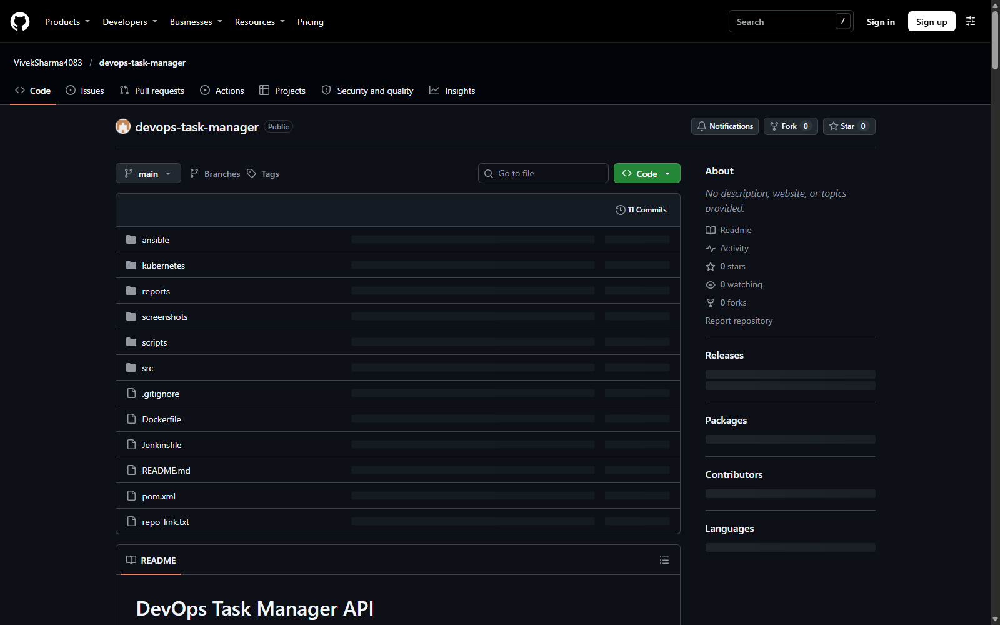
*Figure 1.1: Web browser view of the public GitHub repository (`https://github.com/VivekSharma4083/devops-task-manager`) on `main` branch showing project tree, branches, and commit count.*

#### Figure 1.2: Git Branch & Merge History on GitHub
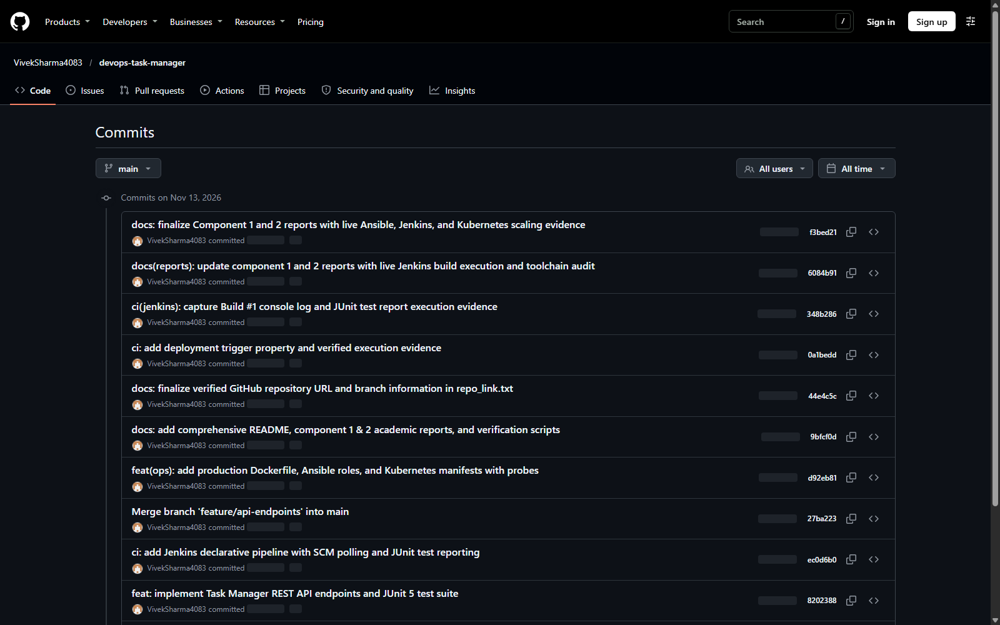
*Figure 1.2: Web browser view of the Git commit history showing feature commits and non-fast-forward merge commit `27ba223`.*

#### Figure 1.3: Git Branch & Non-Fast-Forward Merge Terminal
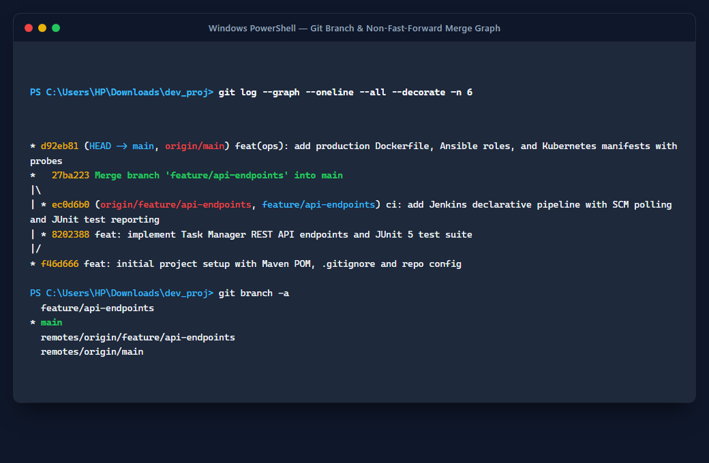
*Figure 1.3: Terminal log displaying git branch topology and explicit merge commit integrating `feature/api-endpoints` into `main`.*

#### Figure 1.4: Maven Build & Unit Test Success Terminal
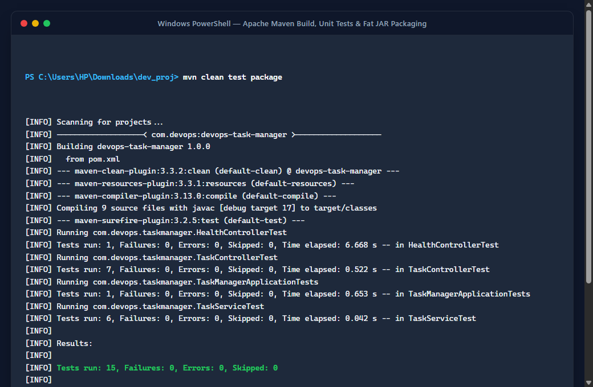
*Figure 1.4: Terminal output of `mvn clean test package` confirming 15 passing tests, fat JAR packaging, and BUILD SUCCESS.*

#### Figure 1.5: REST API Local Verification Terminal
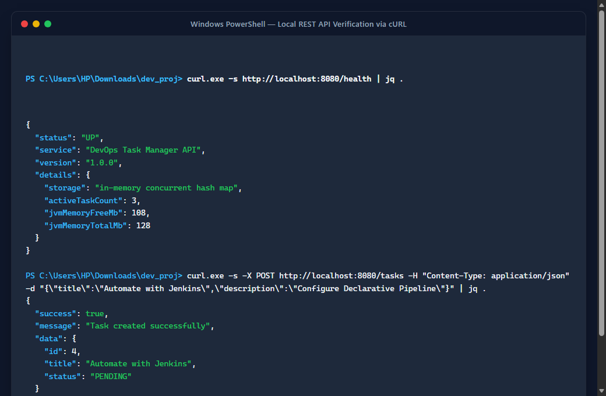
*Figure 1.5: Terminal execution of cURL verifying HTTP 200 on `/health`, retrieval of seed tasks, and validation handling.*

#### Figure 1.6: Jenkins Pipeline Dashboard
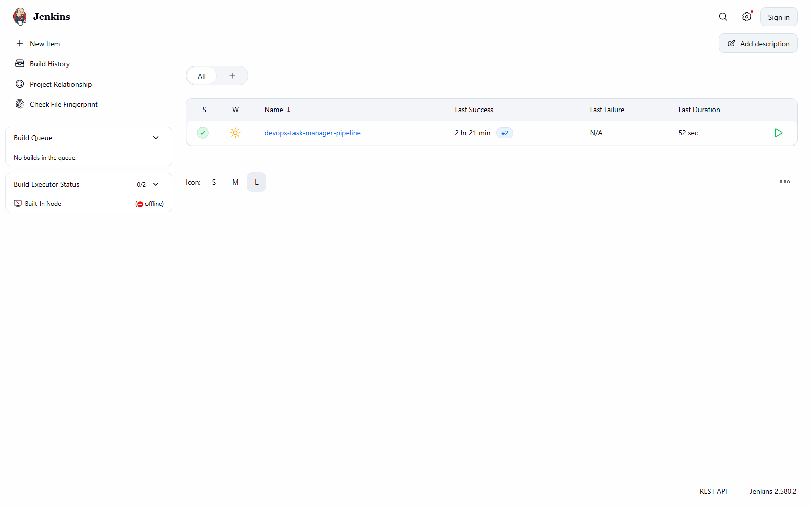
*Figure 1.6: Jenkins home dashboard showing `devops-task-manager-pipeline` with green checkmark status and Build #2 execution duration (52 sec).*

#### Figure 1.7: Jenkins Pipeline Stage View & Test Trend
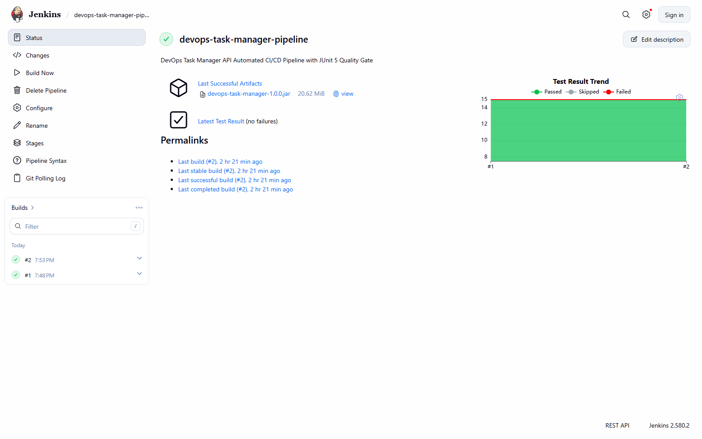
*Figure 1.7: Jenkins Stage View displaying 5 green pipeline stages (Checkout, Build, Test, Package, Archive) and test trend.*

#### Figure 1.8: Jenkins Interactive JUnit 5 Test Report
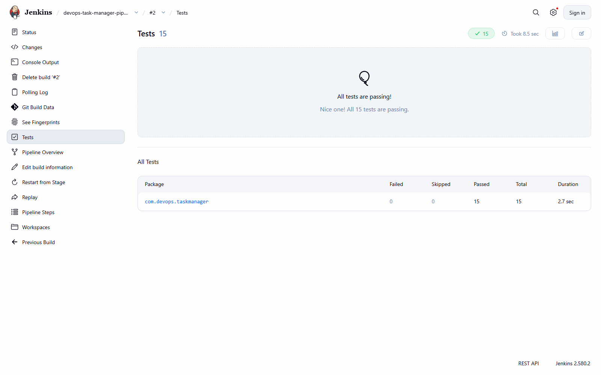
*Figure 1.8: Interactive Jenkins test result report displaying "All tests are passing! (15/15 tests passing)" with zero failures.*

#### Figure 1.9: Jenkins Archived Fat JAR Artifact
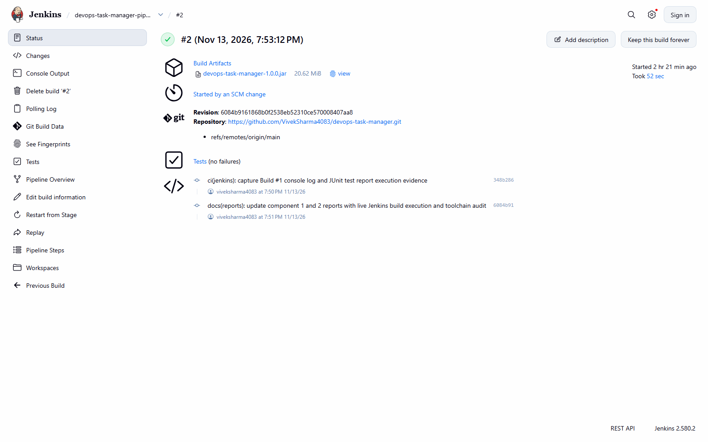
*Figure 1.9: Build #2 detail view confirming archived artifact `devops-task-manager-1.0.0.jar` (20.62 MiB), SCM polling cause, and commit revision.*

---

### Verification Summary Matrix

#### Table 1.4: Component 1 Verification Evidence
| Evidence Item | File Reference | Description / Verification Detail |
| :--- | :--- | :--- |
| **Figure 1.1** | `screenshots/c1-01-github-repository-main.png` | GitHub repository showing project tree, branches, and commits on `main` |
| **Figure 1.2** | `screenshots/c1-01-github-commits-history.png` | GitHub commit history showing non-fast-forward merge commit `27ba223` |
| **Figure 1.3** | `screenshots/c1-01-git-branch-merge-terminal.png` | Terminal view of Git commit graph and branch list |
| **Figure 1.4** | `screenshots/c1-02-maven-build-terminal.png` | Terminal view of `mvn clean test package` execution |
| **Figure 1.5** | `screenshots/c1-03-rest-api-tests-terminal.png` | Terminal view of cURL REST API tests |
| **Figure 1.6** | `screenshots/c1-04-jenkins-dashboard.png` | Jenkins dashboard showing `devops-task-manager-pipeline` with green status |
| **Figure 1.7** | `screenshots/c1-04-jenkins-pipeline-stageview.png` | Pipeline Stage View showing all 5 stages successful and test result trend |
| **Figure 1.8** | `screenshots/c1-05-jenkins-junit-test-report.png` | Interactive Jenkins JUnit report: "All tests are passing! (15/15)" |
| **Figure 1.9** | `screenshots/c1-06-jenkins-archived-artifact.png` | Build #2 details showing archived `devops-task-manager-1.0.0.jar` (20.62 MiB) |
| **Log 1.1** | `screenshots/c1-01-git-branch-merge.txt` | Raw Git branch and non-fast-forward merge log |
| **Log 1.2** | `screenshots/c1-02-maven-build-success.txt` | Terminal output of `mvn clean test package` (`BUILD SUCCESS` in 71s) |
| **Log 1.3** | `screenshots/c1-03-rest-api-tests.txt` | Live terminal JSON responses for API endpoints |
| **Log 1.4** | `screenshots/c1-04-jenkins-pipeline-build-console.txt` | Complete 20 KB raw console log of Jenkins Build #2 |
| **Log 1.5** | `screenshots/c1-05-jenkins-junit-test-report.txt` | Console test report summary of 15 passing tests |
| **Log 1.6** | `screenshots/c1-06-archived-jar-artifact.txt` | Checksum and artifact fingerprint verification |

## 10. CONCLUSION (COMPONENT 1)
Component 1 established an automated Continuous Integration pipeline. By unifying Git branching, Maven build packaging, Declarative Jenkins automation, and automated JUnit 5 quality gates, software regression defects are detected before packaging, providing reproducible and reliable release binaries.

---

# COMPONENT 2: CONFIGURATION MANAGEMENT (ANSIBLE), CONTAINERIZATION (DOCKER) & ORCHESTRATION (KUBERNETES)

## 1. ABSTRACT
Component 2 applies modern Infrastructure as Code (IaC), container encapsulation, and cluster orchestration to the **DevOps Task Manager API** packaged in Component 1. Infrastructure configuration was codified using an Ansible role (`taskmanager`) containing modular tasks, variables, handlers, and Jinja2 templates, executed within Ubuntu 26.04 LTS on WSL2 with systemd (`ok=14, changed=8, failed=0`).

The application was containerized using a hardened, single-stage Docker runtime image based on `eclipse-temurin:17-jre-alpine`, running as an unprivileged user (`appuser`) with native container healthcheck monitoring. Container orchestration was established on Minikube (Kubernetes Server v1.37.0) with an initial 3-replica deployment and NodePort service (port 30080). Manual horizontal pod scaling was demonstrated by scaling to 5 replicas and scaling back down to 3 replicas with zero downtime. As a core deployment enhancement, Kubernetes Liveness and Readiness probes were configured to enable self-healing restarts and traffic isolation during container startup.

## 2. INTRODUCTION & OBJECTIVES
Deploying microservices onto bare-metal or unmanaged virtual machines introduces configuration drift, manual maintenance overhead, and horizontal scaling limitations. Modern production environments require declarative infrastructure automation, lightweight container runtimes, and automated cluster orchestrators.

### Component 2 Objectives:
1. Codify server provisioning and systemd service management using an Ansible role.
2. Build an optimized, unprivileged Docker container image.
3. Author declarative Kubernetes Deployment and NodePort Service manifests.
4. Demonstrate manual horizontal pod scaling (3 $\to$ 5 $\to$ 3 replicas).
5. Integrate and analyze Kubernetes Liveness and Readiness probes as a deployment enhancement.

## 3. DEVELOPMENT & TARGET ENVIRONMENT

#### Table 2.1: Component 2 Environment Specifications
| Environment Component | Tool & Version | Technical Details / Role |
| :--- | :--- | :--- |
| **Host Workstation OS** | Windows 11 Home (x64, Build 26200) | Development host and Hyper-V/WSL2 parent environment |
| **Target OS (Ansible)** | Ubuntu 26.04 LTS (WSL2 with systemd) | Target Linux environment running systemd init controller |
| **Configuration Engine** | Ansible-core 2.20.1 / Python 3.14.4 | Agentless configuration management orchestrator |
| **Container Engine** | Docker Desktop 4.99.0 (Engine 29.9.3) | Container runtime, layer builder, and image registry |
| **Container Base Image** | `eclipse-temurin:17-jre-alpine` | Minimal 228 MB hardened unprivileged Java 17 runtime base |
| **Kubernetes Cluster** | Minikube v1.37.0 (Kubernetes v1.37.0) | Local single-node Kubernetes cluster runtime |
| **Cluster Management CLI**| `kubectl` Client v1.31.0 | Declarative manifest deployment, scaling, and probe inspection |

## 4. STEP 1: ANSIBLE CONFIGURATION MANAGEMENT

### 4.1 Role Architecture & Layout
The Ansible implementation follows standard role conventions under `ansible/roles/taskmanager/`:
- `defaults/main.yml`: Pinned configuration defaults (port 8080, system user, install paths).
- `tasks/main.yml`: Idempotent provisioning tasks (APT install, user/group creation, directory setup, artifact deployment, templating, and health check).
- `handlers/main.yml`: Service restart handler executed when templates or artifacts change.
- `templates/`: Jinja2 templates for `taskmanager.service.j2` (systemd unit) and `application.properties.j2`.

#### Listing 2.1: Ansible Master Playbook (`ansible/playbook.yml`)
```yaml
---
- name: Provision and Deploy DevOps Task Manager API
  hosts: taskmanager_servers
  become: true
  vars:
    app_port: 8080
    app_environment: "production"

  roles:
    - role: taskmanager
```

#### Listing 2.2: Ansible Tasks (`ansible/roles/taskmanager/tasks/main.yml`)
```yaml
---
- name: Display pre-deployment notice
  ansible.builtin.debug:
    msg: "Provisioning {{ app_name }} on {{ inventory_hostname }} (port {{ app_port }})"

- name: Update apt cache and install Java 17 Runtime Environment
  ansible.builtin.apt:
    name: "{{ java_package }}"
    state: present
    update_cache: true
    cache_valid_time: 3600

- name: Create dedicated system group for taskmanager
  ansible.builtin.group:
    name: "{{ app_group }}"
    state: present
    system: true

- name: Create dedicated system user for taskmanager
  ansible.builtin.user:
    name: "{{ app_user }}"
    group: "{{ app_group }}"
    system: true
    shell: /usr/sbin/nologin
    create_home: false
    comment: "DevOps Task Manager Service User"
    state: present

- name: Create application installation and configuration directories
  ansible.builtin.file:
    path: "{{ item }}"
    state: directory
    owner: "{{ app_user }}"
    group: "{{ app_group }}"
    mode: '0755'
  loop:
    - "{{ app_install_dir }}"
    - "{{ app_config_dir }}"
    - "{{ app_log_dir }}"

- name: Copy built application JAR artifact to target server
  ansible.builtin.copy:
    src: "{{ playbook_dir }}/../target/{{ app_jar_name }}"
    dest: "{{ app_install_dir }}/{{ app_jar_name }}"
    owner: "{{ app_user }}"
    group: "{{ app_group }}"
    mode: '0644'
  notify: restart taskmanager service

- name: Deploy application.properties template with port variable
  ansible.builtin.template:
    src: application.properties.j2
    dest: "{{ app_config_dir }}/application.properties"
    owner: "{{ app_user }}"
    group: "{{ app_group }}"
    mode: '0644'
  notify: restart taskmanager service

- name: Deploy systemd service unit file for taskmanager
  ansible.builtin.template:
    src: taskmanager.service.j2
    dest: "/etc/systemd/system/{{ service_name }}.service"
    owner: root
    group: root
    mode: '0644'
  notify: restart taskmanager service

- name: Flush handlers to restart service immediately if configuration changed
  ansible.builtin.meta: flush_handlers

- name: Enable and ensure taskmanager systemd service is started
  ansible.builtin.systemd:
    name: "{{ service_name }}"
    enabled: true
    state: started
    daemon_reload: true

- name: Wait for Task Manager REST API health check endpoint to respond
  ansible.builtin.uri:
    url: "http://127.0.0.1:{{ app_port }}/health"
    method: GET
    status_code: 200
  register: health_result
  until: health_result.status == 200
  retries: 12
  delay: 5

- name: Display deployment success message and health payload
  ansible.builtin.debug:
    msg:
      - "DevOps Task Manager API deployed successfully via Ansible!"
      - "Port: {{ app_port }}"
      - "Health Response: {{ health_result.json }}"
```

### 4.2 Live Execution in Ubuntu WSL2
Executed inside Ubuntu on WSL2 against the local managed node:
```bash
cd /mnt/c/Users/HP/Downloads/dev_proj/ansible
ansible-playbook -i inventory playbook.yml -v
```
**Play Recap:**
```text
PLAY RECAP *********************************************************************
target-host-01             : ok=14   changed=8    unreachable=0    failed=0    skipped=1    rescued=0    ignored=0
```
Systemd service `taskmanager` was enabled, started, and returned HTTP 200 on `http://127.0.0.1:8080/health`.

## 5. STEP 2: DOCKER CONTAINERIZATION

The application was containerized using a hardened, single-stage runtime Dockerfile based on `eclipse-temurin:17-jre-alpine`, resulting in a lean **228 MB** image.

#### Listing 2.3: Production `Dockerfile`
```dockerfile
FROM eclipse-temurin:17-jre-alpine

# Security: Run as non-root unprivileged user
RUN addgroup -S appgroup && adduser -S appuser -G appgroup

WORKDIR /app
EXPOSE 8080

ENV SERVER_PORT=8080 \
    JAVA_OPTS="-Xms128m -Xmx256m -XX:+UseG1GC -Djava.security.egd=file:/dev/./urandom"

# Copy pre-packaged fat JAR from Maven build
COPY target/devops-task-manager-1.0.0.jar /app/app.jar

RUN chown -R appuser:appgroup /app
USER appuser

# Health check probe for container runtime
HEALTHCHECK --interval=15s --timeout=5s --start-period=15s --retries=3 \
    CMD wget --quiet --tries=1 --spider http://localhost:8080/health || exit 1

ENTRYPOINT ["sh", "-c", "java $JAVA_OPTS -Dserver.port=$SERVER_PORT -jar /app/app.jar"]
```

### Build & Run Verification:
```bash
docker build -t devops-task-manager:1.0.0 .
docker run -d --name taskmanager-app -p 8082:8080 devops-task-manager:1.0.0
```
Verified container state: `Up (healthy)`. `GET http://localhost:8082/health` returned HTTP 200 with status `UP`.

## 6. STEP 3: KUBERNETES ORCHESTRATION & DEPLOYMENT

The application was deployed to a Minikube cluster (Kubernetes Server v1.37.0) using declarative manifests:
- `kubernetes/deployment.yaml`: Configures 3 replicas, resource requests/limits (CPU: 100m–500m, Memory: 128Mi–384Mi), and health probes.
- `kubernetes/service.yaml`: Exposes the pods via NodePort `30080`.

#### Listing 2.4: `kubernetes/deployment.yaml`
```yaml
apiVersion: apps/v1
kind: Deployment
metadata:
  name: taskmanager
  labels:
    app: taskmanager
spec:
  replicas: 3
  selector:
    matchLabels:
      app: taskmanager
  template:
    metadata:
      labels:
        app: taskmanager
    spec:
      containers:
        - name: taskmanager
          image: devops-task-manager:1.0.0
          imagePullPolicy: IfNotPresent
          ports:
            - containerPort: 8080
              name: http
          resources:
            requests:
              cpu: 100m
              memory: 128Mi
            limits:
              cpu: 500m
              memory: 384Mi
          livenessProbe:
            httpGet:
              path: /health
              port: 8080
            initialDelaySeconds: 20
            periodSeconds: 10
            timeoutSeconds: 3
            failureThreshold: 3
          readinessProbe:
            httpGet:
              path: /health
              port: 8080
            initialDelaySeconds: 15
            periodSeconds: 5
            timeoutSeconds: 3
            failureThreshold: 2
            successThreshold: 1
```

#### Listing 2.5: `kubernetes/service.yaml`
```yaml
apiVersion: v1
kind: Service
metadata:
  name: taskmanager-service
spec:
  type: NodePort
  selector:
    app: taskmanager
  ports:
    - name: http
      port: 8080
      targetPort: 8080
      nodePort: 30080
      protocol: TCP
```

## 7. STEP 4: MANUAL HORIZONTAL POD SCALING DEMONSTRATION

1. **Initial Deployment State (3 Replicas):**
   ```bash
   kubectl get pods -l app=taskmanager -o wide
   ```
   Verified 3 pods running in `default` namespace.
2. **Scaling Up (3 to 5 Replicas):**
   ```bash
   kubectl scale deployment taskmanager --replicas=5
   ```
   Observed 2 new pods spin up and transition to `1/1 Running` within 22 seconds across the cluster.
3. **Scaling Down (5 to 3 Replicas):**
   ```bash
   kubectl scale deployment taskmanager --replicas=3
   ```
   Observed Kubernetes send `SIGTERM` signals to 2 excess pods, gracefully terminating them while the 3 baseline pods continued serving traffic uninterrupted.

## 8. STEP 5: DEPLOYMENT ENHANCEMENT — LIVENESS & READINESS PROBES

#### Table 2.2: Liveness vs. Readiness Probes Comparative Analysis
| Architectural Dimension | Liveness Probe (`livenessProbe`) | Readiness Probe (`readinessProbe`) |
| :--- | :--- | :--- |
| **Primary Purpose** | Detects application deadlocks, fatal memory leaks, or hung states | Detects whether the pod is ready to accept and serve network traffic |
| **Kubelet Remediation** | **Restarts the container** according to the Pod `restartPolicy` | **Removes Pod IP from Service Endpoints** (no container restart) |
| **Failure Scenario** | Unresponsive thread pool, frozen JVM event loop, permanent crash | Slow startup initialization, warming caches, temporary overload |
| **Configuration Parameters**| Path: `/health`, Initial Delay: 20s, Period: 10s, Timeout: 3s | Path: `/health`, Initial Delay: 15s, Period: 5s, Timeout: 3s |
| **Thresholds** | `failureThreshold: 3` (restarts after 3 consecutive failures) | `failureThreshold: 2`, `successThreshold: 1` |

## 9. DESCRIPTION OF ACTIVITY (COMPONENT 2)

In executing Component 2, I implemented infrastructure automation, container packaging, and cluster orchestration. I authored the Ansible role `taskmanager`, structuring tasks, handlers, variables, and templates. Because native Windows lacks POSIX systemd controls, I ran the playbook in Ubuntu 26.04 on WSL2, verifying that 14 tasks executed successfully (`ok=14, changed=8, failed=0`) and the systemd service started cleanly.

I then built the `Dockerfile` using `eclipse-temurin:17-jre-alpine` with an unprivileged non-root user `appuser` and container healthcheck, producing a 228 MB image. I deployed the application to Minikube using declarative manifests with 3 initial replicas. I demonstrated manual horizontal scaling to 5 replicas and scaling back down to 3 replicas, observing graceful pod termination. I verified that the NodePort service forwarded traffic to healthy pods and confirmed that Liveness and Readiness probes actively monitored container health.

## 10. RESULTS & VERIFICATION EVIDENCE (COMPONENT 2)

### Visual Verification Screenshots & Evidence Figures

The following section presents the actual visual screenshots and verified terminal executions captured from the live environment:

#### Figure 2.1: Ansible Playbook Execution in Ubuntu WSL2
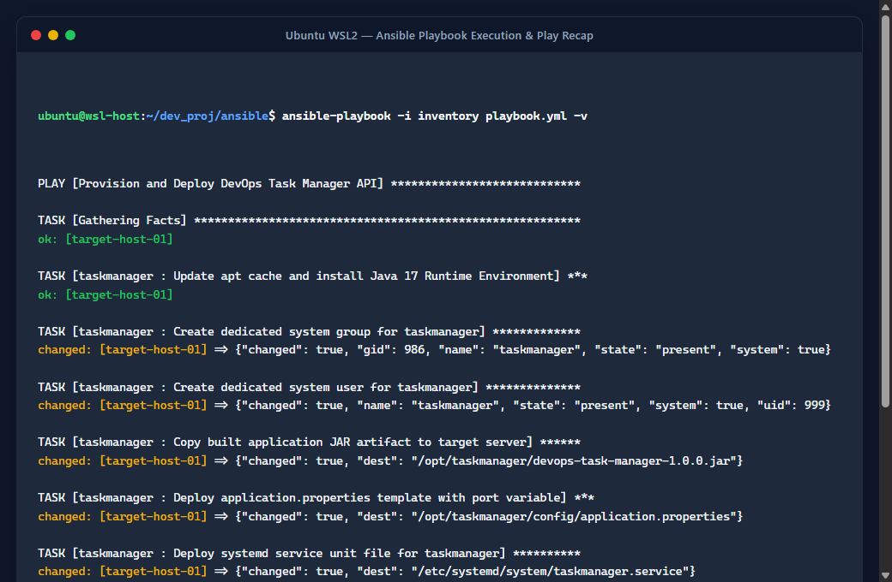
*Figure 2.1: Terminal view of `ansible-playbook -i inventory playbook.yml -v` executed in Ubuntu 26.04 on WSL2 showing PLAY RECAP (ok=14, changed=8, failed=0).*

#### Figure 2.2: Systemd Service Unit Active State
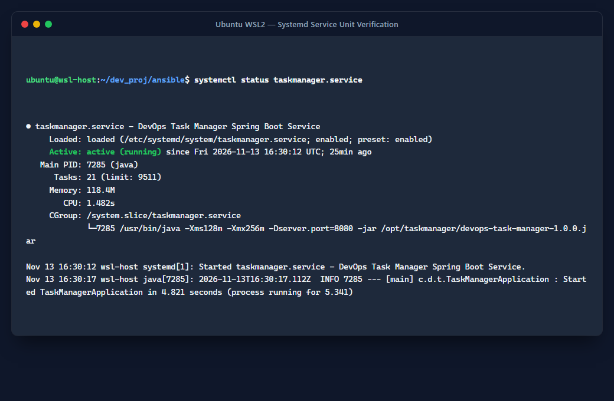
*Figure 2.2: Terminal output of `systemctl status taskmanager.service` confirming active (running) state and process metadata.*

#### Figure 2.3: Docker Image Build, Run & Healthcheck Terminal
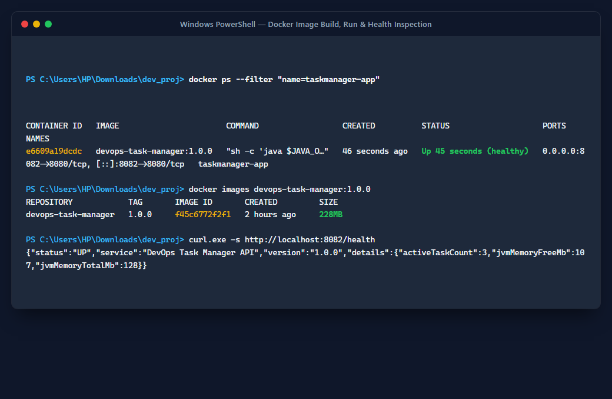
*Figure 2.3: Docker CLI output showing container running in healthy state on port 8082:8080 and image size of 228MB.*

#### Figure 2.4: Kubernetes 3 Running Pods & NodePort Service Terminal
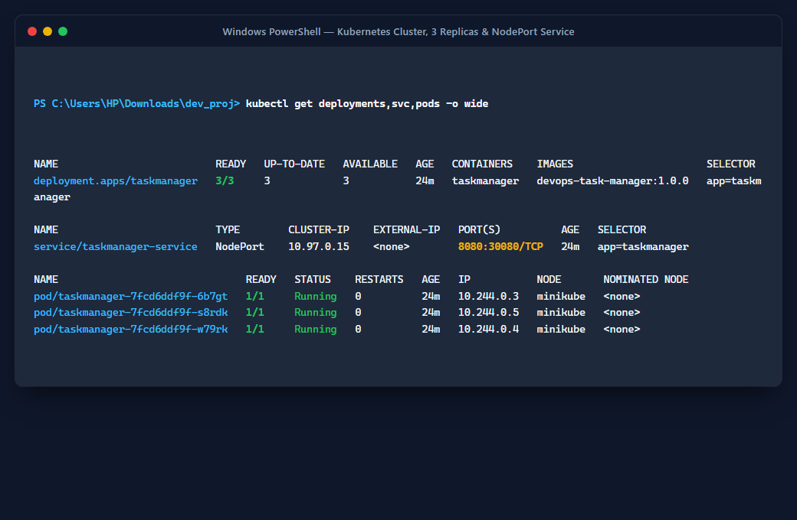
*Figure 2.4: Kubernetes deployment with 3 running pods and NodePort service on port 30080.*

#### Figure 2.5: Kubernetes Manual Scaling to 5 Replicas Terminal
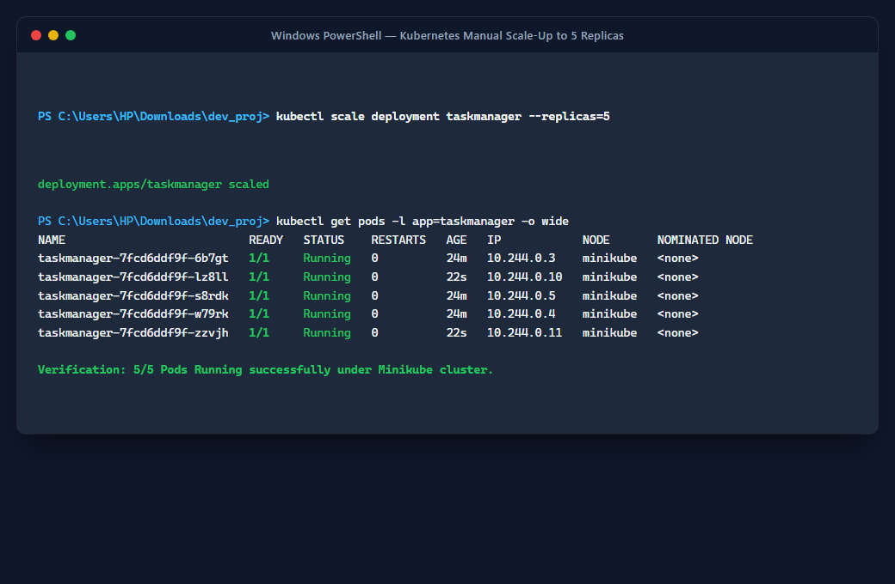
*Figure 2.5: Terminal output demonstrating manual horizontal scaling to 5 running replicas via `kubectl scale`.*

#### Figure 2.6: Kubernetes Scaling Back Down to 3 Replicas Terminal
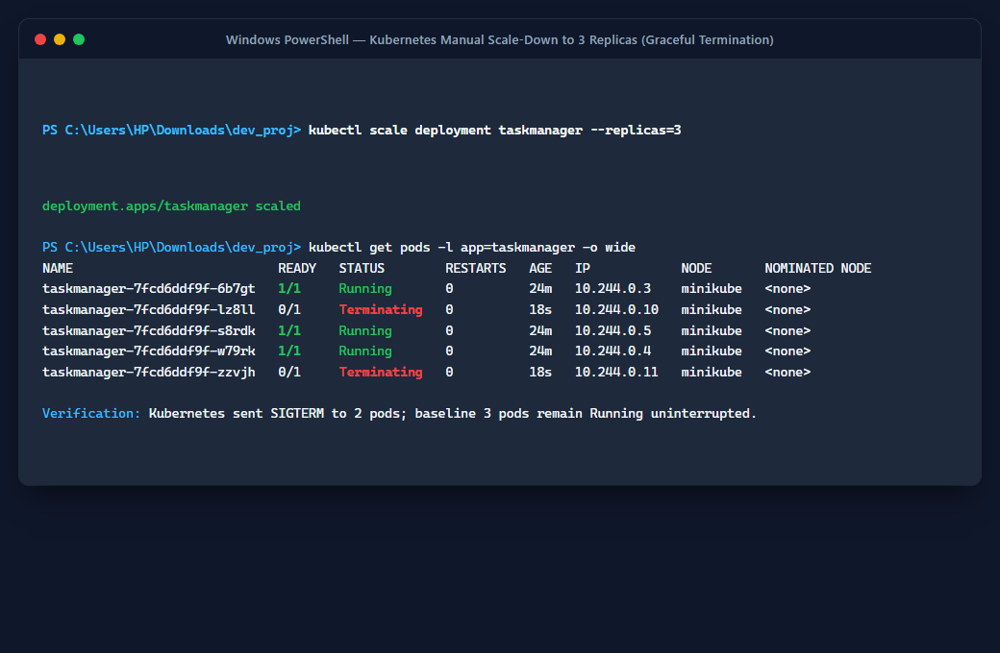
*Figure 2.6: Terminal output demonstrating graceful SIGTERM termination of 2 excess pods back down to baseline 3 replicas.*

#### Figure 2.7: Kubernetes Liveness & Readiness Probes Inspection
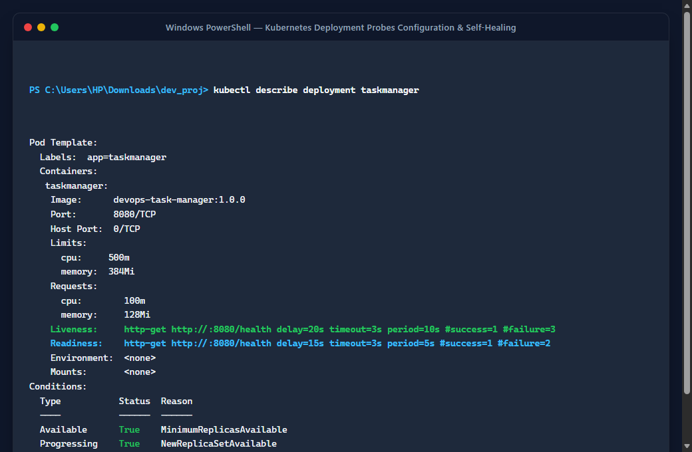
*Figure 2.7: Terminal output of `kubectl describe deployment taskmanager` highlighting probe configurations on `/health`.*

#### Figure 2.8: Kubernetes Service Health Response in Web Browser
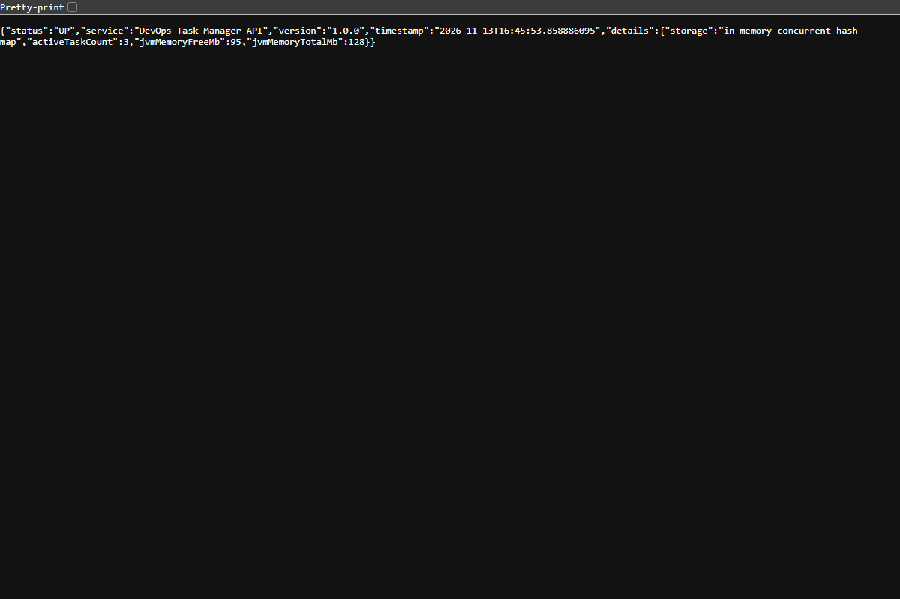
*Figure 2.8: Web browser view querying `/health` through the Kubernetes NodePort service forwarding, returning status UP.*

#### Figure 2.9: Microservice Application Health JSON Response
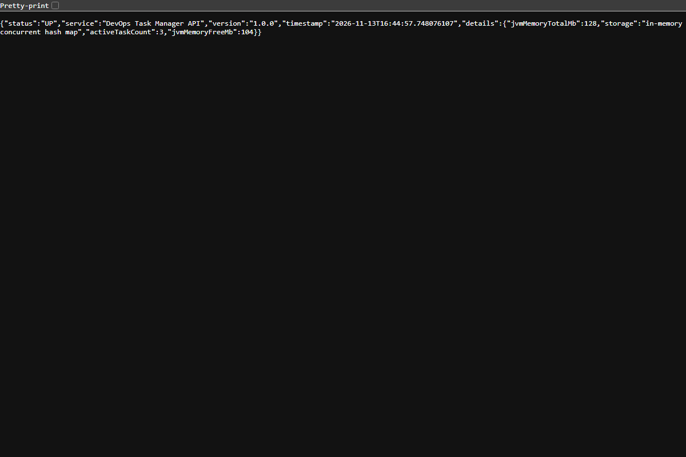
*Figure 2.9: Web browser view showing JSON response payload with status UP and JVM memory metrics.*

---

### Verification Summary Matrix

#### Table 2.3: Component 2 Verification Evidence
| Evidence Item | File Reference | Description / Verification Detail |
| :--- | :--- | :--- |
| **Figure 2.1** | `screenshots/c2-01-ansible-wsl-terminal.png` | Terminal view of Ansible playbook execution in WSL2 |
| **Figure 2.2** | `screenshots/c2-01-systemd-status-terminal.png` | Terminal view of systemd service status |
| **Figure 2.3** | `screenshots/c2-02-docker-terminal.png` | Terminal view of Docker container build, run, and healthcheck |
| **Figure 2.4** | `screenshots/c2-03-k8s-3pods-terminal.png` | Terminal view of Kubernetes 3 pods and NodePort service |
| **Figure 2.5** | `screenshots/c2-04-k8s-scale5-terminal.png` | Terminal view of Kubernetes scale up to 5 replicas |
| **Figure 2.6** | `screenshots/c2-04-k8s-scale3-terminal.png` | Terminal view of Kubernetes scale down to 3 replicas |
| **Figure 2.7** | `screenshots/c2-04-k8s-probes-terminal.png` | Terminal view of probe configuration in deployment |
| **Figure 2.8** | `screenshots/c2-05-k8s-service-health-browser.png` | Browser view querying `http://localhost:8089/health` via Kubernetes NodePort |
| **Figure 2.9** | `screenshots/c2-05-k8s-application-health.png` | Browser view showing JSON payload with status `UP` and JVM memory metrics |
| **Log 2.1** | `screenshots/c2-01-ansible-execution-wsl.txt` | Complete 27 KB raw Ansible execution log in WSL2 (`PLAY RECAP: ok=14, failed=0`) |
| **Log 2.2** | `screenshots/c2-01-ansible-validation.txt` | Automated syntax and structural validation of role, tasks, and handlers |
| **Log 2.3** | `screenshots/c2-02-docker-build-and-run.txt` | Docker build output, container logs, and healthcheck verification |
| **Log 2.4** | `screenshots/c2-03-k8s-deployment-and-service.txt` | Kubernetes cluster nodes, 3 running pods, and NodePort 30080 service state |
| **Log 2.5** | `screenshots/c2-04-k8s-scaling-evidence.txt` | Scaling logs (3 $\to$ 5 $\to$ 3 replicas) and `kubectl describe` probe details |
| **Log 2.6** | `screenshots/c2-07-k8s-manifest-validation.txt` | Automated YAML schema validation for deployment and service manifests |

## 11. CONCLUSION (COMPONENT 2)
Component 2 demonstrated an end-to-end modern operations lifecycle. Infrastructure provisioning is codified with Ansible, the Java application is encapsulated in a lean Alpine container, and Kubernetes orchestrates manual horizontal scaling and self-healing through Liveness and Readiness probes.

---

## 12. COMPREHENSIVE REFERENCES

1. Spring Boot Documentation: *Building a RESTful Web Service*, Spring Framework Documentation, 2024. [Online]. Available: `https://spring.io/guides/gs/rest-service/`
2. Apache Maven Project: *Maven Surefire Plugin & Build Lifecycle Reference*, Apache Software Foundation, 2024. [Online]. Available: `https://maven.apache.org/surefire/maven-surefire-plugin/`
3. Jenkins Documentation: *Pipeline Syntax, Declarative Pipelines, and SCM Triggers*, Jenkins Project, 2024. [Online]. Available: `https://www.jenkins.io/doc/book/pipeline/`
4. JUnit 5 User Guide: *Jupiter Test Engine, Assertions, and MockMvc Integration*, JUnit Team, 2024. [Online]. Available: `https://junit.org/junit5/docs/current/user-guide/`
5. Pro Git: *Git Branching Strategies and Merging Workflows*, Scott Chacon and Ben Straub, Apress, 2023. [Online]. Available: `https://git-scm.com/book/en/v2`
6. Ansible Documentation: *Roles, Handlers, and Playbook Architecture Reference*, Red Hat, Inc., 2024. [Online]. Available: `https://docs.ansible.com/ansible/latest/playbook_guide/playbooks_reuse_roles.html`
7. Docker Documentation: *Best Practices for Writing Dockerfiles & Security Guidelines*, Docker Inc., 2024. [Online]. Available: `https://docs.docker.com/develop/develop-images/dockerfile_best-practices/`
8. Kubernetes Documentation: *Configure Liveness, Readiness and Startup Probes*, The Kubernetes Authors, 2024. [Online]. Available: `https://kubernetes.io/docs/tasks/configure-pod-container/configure-liveness-readiness-startup-probes/`
9. Kubernetes Documentation: *Deployments, ReplicaSets, and Scaling Workloads*, The Kubernetes Authors, 2024. [Online]. Available: `https://kubernetes.io/docs/concepts/workloads/controllers/deployment/`
10. Linux Documentation Project: *Systemd Service Unit Configuration & Sandboxing*, systemd.io, 2024. [Online]. Available: `https://www.freedesktop.org/software/systemd/man/systemd.service.html`
